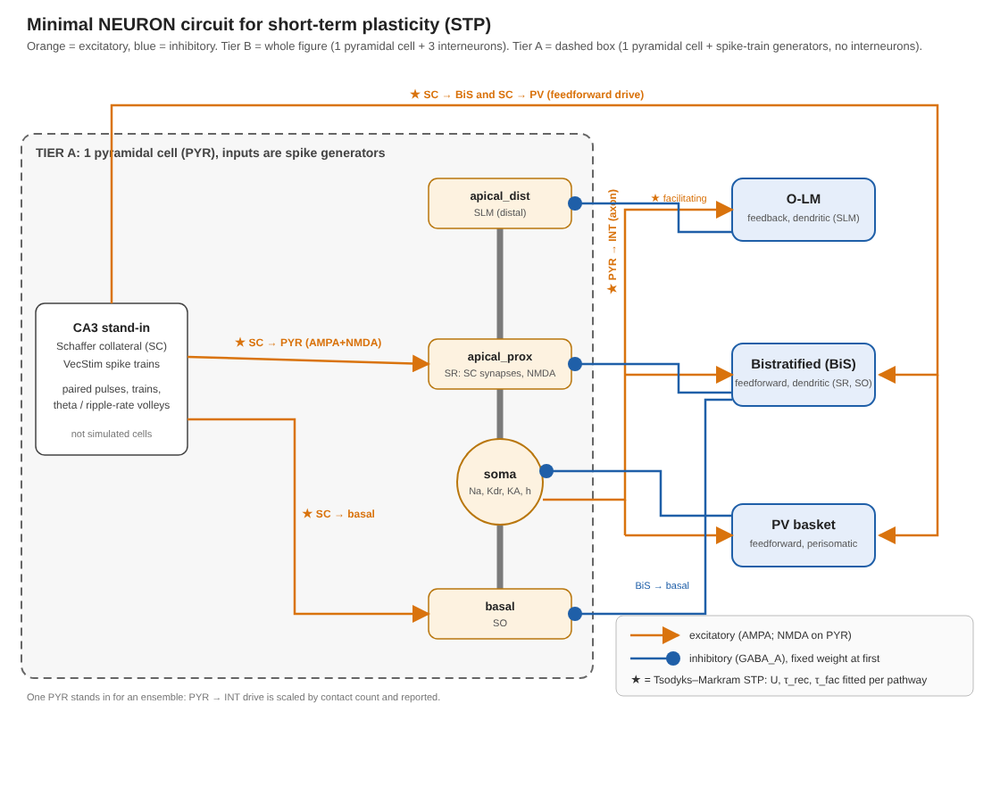

# tinyHippo-bio-plasticity

NEURON implementation of the bio-plausible plasticity specified in
[**hippocampal_plasticity_model.md**](hippocampal_plasticity_model.md) (the main approach file),
tested in a minimal CA1 circuit (1 pyramidal cell, up to 3 interneurons) with
biological timescales.

**Milestone 1:** short-term plasticity (Tsodyks–Markram) per synapse class.
**Next:** synaptic tagging and capture, falsification tests, graded `V_seg`.



*Orange = excitatory, blue = inhibitory. Tier A (dashed box) = 1 pyramidal cell driven by
spike generators. Tier B = Tier A plus PV basket, bistratified and O-LM cells.*

## Contents

- [docs/handoff.md](docs/handoff.md): decisions, status, blockers and next steps (read first).
- [docs/plan.md](docs/plan.md): the plan, stages S0–S7 (S3 is S3a–S3e) and acceptance criteria.
- [docs/replan_stp_balance.md](docs/replan_stp_balance.md): state of the programmed CA1 and the upscaling/downscaling balance inside the STP boundary.
- [docs/ca1_architecture_literature.md](docs/ca1_architecture_literature.md): the Tier-B circuit checked against the literature, with the STP parameters in `params.py`.
- [docs/sources_to_download.md](docs/sources_to_download.md): papers to download, by what they unblock.
- [hippocampal_plasticity_model.md](hippocampal_plasticity_model.md): the main approach file, the plasticity model (timescales, cellular vs. system consolidation, tag/capture, graded tag amplitude `V_seg`).
- [hippocampal_memristive_implementation.md](hippocampal_memristive_implementation.md): neuron architecture (dendritic-convolution pipeline) and its memristive and digital hardware implementation.
- [hippocampal_downscaling_mechanisms.md](hippocampal_downscaling_mechanisms.md): mechanisms that weaken synapses or bound their total, with timescales and model hooks.
- [docs/neuron_model_optimization.md](docs/neuron_model_optimization.md): hardware-feasibility companion to the memristive implementation.
- `mod/`, `tests/`: NMODL mechanisms (`TMSyn`, `S0Check`) and tests.
- `cells.py`, `circuit.py`, `run_s3_pilot.py`: the Tier-B pilot circuit (placeholder cell biophysics); `run_s2_lit.py`: S2 on the literature parameters.
- [RESULTS.md](RESULTS.md): numbered experiment log.

## Setup

```bash
python3 -m venv .venv && . .venv/bin/activate
pip install -r requirements.txt
pytest -q tests          # S0, S1: compiles mod/ with nrnivmodl, checks Exp2Syn, event handling and TMSyn
python run_s1.py         # prints the S1 error table
```

Tested with NEURON 9.0.2, Python 3.13, numpy 2.5, scipy 1.18, matplotlib 3.11, pytest 9.1 (Linux x86_64; also macOS arm64).
NEURON needs Python 3.9–3.13; if `PYTHONPATH` points at a NEURON app bundle, unset it (it shadows the pip install). On macOS the mechanisms build to `libnrnmech.dylib`.
`nrn_setup.load_mechanisms()` recompiles `mod/` when a `.mod` file is newer than the build.

## Status

S0 (environment) and S1 (`TMSyn` verified against the closed-form Tsodyks–Markram solution, [RESULTS.md §1](RESULTS.md)) pass. S2: the paired-pulse sign test passes on 9 pathways with secondary-source parameters ([§3](RESULTS.md)); it stays open until the primary papers are read. S3 is a pilot: the Tier-B circuit runs with placeholder cell biophysics ([§4](RESULTS.md)); the replanned stages S3a–S3e are in [docs/plan.md](docs/plan.md). S4–S7 not started. Details and next steps: [docs/handoff.md](docs/handoff.md).
