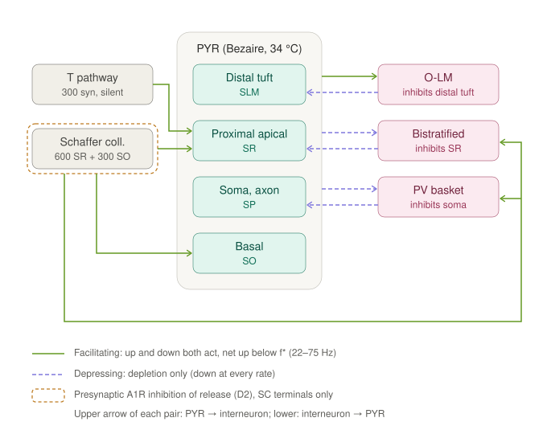
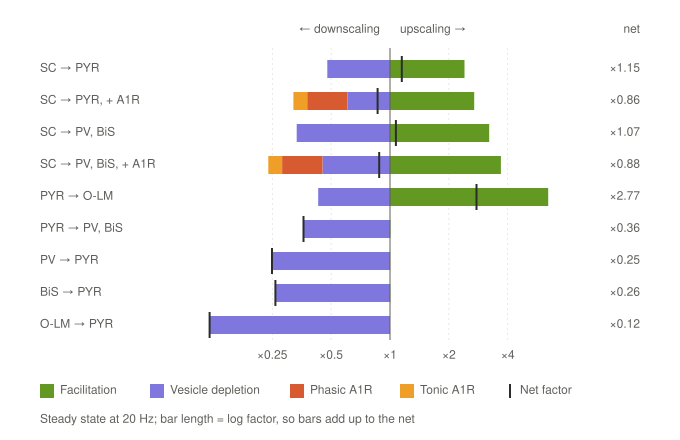

# Upscaling and downscaling in the Tier-B circuit

Where the weight of each synapse is scaled up or down by the mechanisms implemented so far, and by how much.
Both figures are made by `make_fig_up_down.py`; numbers and caveats are in [RESULTS.md §13](../RESULTS.md).

## Where they act

- **Upscaling = facilitation** (Tsodyks–Markram `u`, `mod/TMSyn.mod`): SC → PYR (and the tagged T pathway, same
  parameters), SC → PV and SC → BiS, PYR → O-LM. Vesicle depletion acts on the same synapses, so the net is up only
  below the crossover f* (27.5, 22.6 and 75.4 Hz; RESULTS §5, §12).
- **Downscaling #1 = vesicle depletion** (`x`): every synapse. On PYR → PV/BiS and on all three interneuron → PYR
  synapses it is the only term.
- **Downscaling #2 = presynaptic A1R inhibition of release** (`mod/TMSynPI.mod`, tonic + phasic): SC terminals only,
  values from Mitchell et al. 1993 (RESULTS §11). GABA_B has a maximum but no kinetics and is not run.
- Not yet implemented: postsynaptic plasticity (tag and capture, S4–S6) and homeostatic scaling
  (`hippocampal_downscaling_mechanisms.md`).

## How large they are (steady state, 20 Hz)

Bars are log factors, so they add up to the net mark. PYR → O-LM is the only synapse clearly upscaled at 20 Hz
(×2.8). The SC synapses are a near-cancellation of large up and down terms (net ×1.07–1.15), and A1R inhibition
turns them net down (×0.86–0.88). Inhibition onto PYR is the most downscaled (×0.12–0.26).
These are single-synapse values; the circuit run waits on `circuit._place`.
