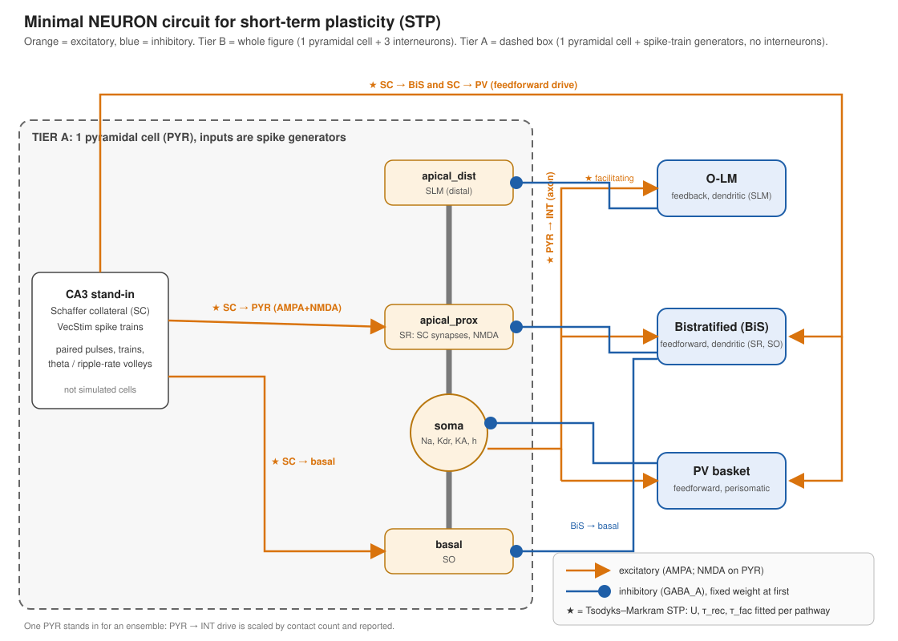

# Plan: minimal NEURON circuit for short-term plasticity and tag/capture dynamics

**Model:** [hippocampal_plasticity_model.md](../hippocampal_plasticity_model.md) §1, §2, §2.1; architecture: [hippocampal_memristive_implementation.md](../hippocampal_memristive_implementation.md) §7.3, §7.4.
Milestone 2 models the synaptic correlate of *cellular* consolidation (model §1, terminology);
system consolidation is out of scope.



*Orange = excitatory, blue = inhibitory. Tier A = 1 PYR driven by spike generators. Tier B = Tier A plus PV basket, bistratified and O-LM cells.*

## 0. Purpose and scope

Build a small, biophysical NEURON testbed of a CA1 pyramidal cell (PYR) and its
interneurons that shows how synaptic weights evolve over the spec's timescales,
simulated in real (biological) units with no time compression.

1. **Milestone 1 (S0–S3): short-term plasticity (STP)**, 10 ms–1 s, for each synapse class.
   The balance between upscaling (facilitation) and downscaling (depression) is studied **inside the STP
   boundary**: processes with time constants up to about 1 s, plus static or phasic `U` gains set per run
   (presynaptic inhibition, [Ca²⁺]ₒ dependence). Everything slower (downscaling mechanisms #4–#13 of
   [hippocampal_downscaling_mechanisms.md](../hippocampal_downscaling_mechanisms.md)) is deferred to after
   S4–S6. Consequence: inside STP, short-term depression is the only fast compensatory process, so nothing
   limits runaway potentiation until those later mechanisms are added. Derivation and numbers:
   [replan_stp_balance.md](replan_stp_balance.md).
2. **Milestone 2 (S4–S6): tag/capture**, minutes–hours: the spec's Fig. 2, its two
   falsification tests, and the graded `V_seg` mechanism of model §2.1.

Out of scope: emergent sharp-wave-ripple generation, replay ordering as a network
property, and anything that needs hundreds of cells.

## 1. How small can the circuit be?

STP and synaptic tagging are **synapse-local** (the plasticity-related-protein (PRP) pool is
cell-wide, but per cell). The minimum is therefore set by what is read out:

| Tier | Cells | Enough for | Not enough for |
|---|---|---|---|
| **A** | 1 PYR, 0 interneurons; presynaptic inputs are spike generators (`VecStim`) | STP of each synapse class (paired-pulse ratio, train depression/facilitation); tag/capture; Frey–Morris weak/strong design | Circuit-level effects of STP: E/I balance, dendritic gating |
| **B (target)** | 1 PYR + 3 interneurons (PV basket, bistratified, O-LM) | Everything in A, plus how STP at each pathway shapes PYR output and the E/I ratio during a volley | Population effects: ensemble competition, ripple emergence |
| **C (optional)** | 5–10 PYR + the same 3 interneurons | Reciprocal PYR→INT→PYR loops with more than one source | Ripple generation |

The three interneurons cover the three canonical CA1 inhibitory motifs:

| Interneuron | Motif | Target on PYR | Input | Role |
|---|---|---|---|---|
| **PV basket** | feedforward, perisomatic | soma | Schaffer collateral (SC) + PYR | The model's `Cluster3` bypass (implementation §7.3): inhibition that skips the threshold/junction pipeline |
| **Bistratified** | feedforward, dendritic | proximal apical (SR) + basal (SO) | SC + PYR | Dendritic inhibition acting on `V_seg` of the segment that carries SC synapses |
| **O-LM** | feedback, dendritic | distal apical (SLM) | PYR only | Facilitating feedback onto a segment separate from SC; a pure STP readout |

Caveat: with one PYR, the PYR→INT drive stands in for an ensemble. Scale it by the
contact count and report that factor. Do not read Tier-B E/I numbers as population values.
Precedent for this size: Cutsuridis, Cobb & Graham (2010, *J Comput Neurosci*), a CA1
microcircuit with one cell of each interneuron class; Bezaire et al. (2016, *eLife*), the full
CA1 NEURON model (ModelDB 187604), a source for channel and interneuron parameters.
(Both citations are from memory; verify before use. They are also the candidate sources for the S3b cell
calibration, together with Migliore et al. 2018, the CA1 cell models used by Ecker et al. 2019.)

## 2. Circuit specification (Tier B)

```
CA3 (SC) stand-in ──┬─► PYR.apical_prox (SR)   AMPA+NMDA, TM-STP        ← strong pathway S
 VecStim trains     ├─► PYR.basal (SO)
                    ├─► PV.soma                AMPA, TM-STP
                    └─► BiS.soma               AMPA, TM-STP
T pathway (weak) ───────► PYR.apical_prox (SR)   AMPA+NMDA, TM-STP + tag/capture   ← tagged pathway T
PYR.soma ──► PV, BiS, OLM  (AMPA, TM-STP)
PV ──► PYR.soma (GABA_A)    BiS ──► PYR.apical_prox + basal (GABA_A)    OLM ──► PYR.apical_dist (GABA_A)
```

- **PYR:** soma + basal + apical_prox + apical_dist (4 sections). Na, Kdr, K_A and
  h conductances in the soma. Dendrites start passive; Na/K are added only to test the
  dendritic-spike `thr` of implementation §7.1 (S5).
- **Interneurons:** one compartment each, Na/Kdr, with class-specific rheobase and
  membrane τ.
- **Synapses:** AMPA (Exp2Syn kinetics) and NMDA with the Jahr–Stevens Mg²⁺ block
  (needed for model §2.1); GABA_A.

### Mechanisms to write (NMODL, `NET_RECEIVE`-based, CVODE-safe via `state_discontinuity`)

1. **`TMSyn.mod`**: Tsodyks–Markram synapse. State `u` (utilisation), `x` (available
   resources). On spike n: `u⁺ = u⁻ + U(1−u⁻)`, `Δg = w·u⁺·x⁻`, `x⁺ = x⁻ − u⁺·x⁻`.
   Between spikes: `du/dt = −u/τ_fac`, `dx/dt = (1−x)/τ_rec`. Parameters `U, τ_rec, τ_fac`
   per pathway. Optional stochastic release: N sites, Bernoulli with `p = u⁺·x⁻`
   (Random123, fixed seed).
2. **`SegTag.mod`** (model §2 + §2.1), one instance per tagged synapse group:
   - `τ_v · dV_seg/dt = −V_seg + Σ wᵢ·sᵢ` (τ_v 10–30 ms)
   - `g_Ca(V_seg) = 1/(1 + K·exp(−λ·V_seg))`
   - tag set by a coincident pre/post event: `T ← T + g_Ca(V_seg)·[dSpike]`; `dT/dt = −T/τ_tag`
   - PRP pool `P`: incremented by somatic burst events while synthesis is on, decays with `τ_P`:
     `P ← P + ΔP·s(t)` per burst, `dP/dt = −P/τ_P`. `s(t) ∈ {0, 1}` is the protein-synthesis gate;
     `s = 0` from `t_b` onward models a protein-synthesis inhibitor applied at `t_b` (S4(d)). Proteins
     already made are not removed; they decay with `τ_P`.
   - **gradual capture** (decided 2026-10-22, `docs/handoff.md` decision 8): captured weight grows at a
     rate set by both tag and PRP, and captured tag leaves `T`:
     ```
     h(P)          = Pⁿ / (Pⁿ + θ_PRPⁿ)                (soft PRP threshold)
     dw_cap/dt     =  k_cap · h(P) · T
     dT/dt         = −T/τ_tag − k_cap · h(P) · T
     ```
     The protein-synthesis-sensitive window is then an output of the model (set by `τ_P`, `k_cap`,
     `τ_tag`, `θ_PRP`, `n`), not an input. Why gradual: the protein-synthesis dependence of late-LTP and
     of cellular consolidation declines over time rather than switching at one instant, and existing
     tag/capture models treat the late phase as a variable relaxing over ~1 h or more (Clopath et al.
     2008; Barrett et al. 2009; cited from memory, unverified). The spec's "discrete regime change"
     (model §1, row 6) refers to the end state (captured weight no longer decays), which this keeps.
   - instantaneous capture (the original design: when `P ≥ θ_PRP` and `T > 0`, `w_cap += κ·T`, `T → 0`)
     is the limit `k_cap → ∞`, `n → ∞`. It is kept as a switch for comparison, not as the default.
   - `θ_PRP = 999` disables capture (`h ≈ 0`; the blocked-capture arm of the falsification test).
   - parameters `k_cap` and `n` have no source; they are swept in S4 (no values from memory).
3. **STDP in the tag step:** ±20 ms window (A₊, A₋).

Time scales: the slow module runs in **real units** (τ_tag 1–4 h). With gradual capture the
slow ODEs between events are no longer linear decays (`h(P)·T` couples them), but they are smooth
and slow, so CVODE should take long steps; hours of simulated time should still be cheap. This is a
risk to check in S4; the fallback is a numpy reference of the slow subsystem (also required by
the S1-style verification rule) integrated between events.

## 3. Stages and acceptance criteria

| Stage | Experiment | Pass criterion |
|---|---|---|
| **S0** | Environment: `pip install neuron`, `nrnivmodl`, run a toy `Exp2Syn` | Imports and compiles; NEURON version recorded in the README |
| **S1** | **Verify `TMSyn`** against the closed-form TM solution in numpy: 2-pulse and 20-pulse trains at 5, 20, 50 Hz | Relative error of every Δg < 1%; CVODE vs fixed dt = 25 µs differ < 2% |
| **S2** | **STP signatures per pathway** (voltage clamp at −70 mV, PYR and each interneuron): paired-pulse ratio at ISI 20–500 ms; steady-state amplitude vs frequency | Sign of PPR−1 matches the expected class from the sourced parameters in `params.py` (secondary sources so far, `RESULTS.md` §3): SC→PYR and SC→interneuron facilitating (PPR > 1 at ISI ≤ 200 ms), PYR→PV/BiS depressing, PYR→OLM facilitating, all interneuron→PYR depressing. (The earlier "SC→PV depressing" is not supported by the Wierenga & Wadman 2003 values, quoted via the Hippocampus Hub; re-check against the primary text.) Target values are taken from the literature **before** fitting. `U, τ_rec, τ_fac` fit by least squares with CIs. **Open until** the primary texts of Wierenga & Wadman 2003 and Losonczy et al. 2002 are read |
| **S3a** | **Balance map, single synapse.** Balance index `B(f) = R_ss(f)/U` (steady-state release per spike relative to the first spike), `f*` (where `B = 1`) and release `R(f)` per pathway, `f` = 1–300 Hz, `U` gain ∈ {0.5, 0.75, 1, 1.25, 1.5}, from the NEURON clamp (`run_clamped`) against the closed form | NEURON vs closed form < 1% at every (pathway, f, gain); `f*` and the sign of `B − 1` reported per pathway; the prediction that a `U` gain moves `f*` but not the saturated high-rate release is confirmed or refuted. Closed-form expectation (`replan_stp_balance.md` §3): SC→PYR `f*` ≈ 27.5 Hz, inhibitory pathways `B < 1` at every rate |
| **S3b** | **Cell calibration.** Replace the placeholder cells (`hh` soma, passive dendrites) with sourced biophysics; DC rheobase and f–I curve of PYR and the three interneurons compared with values read from the literature (candidate sources, not yet read: Bezaire et al. 2016, Migliore et al. 2018) | PYR and interneuron rheobase and f–I within the cited range; PYR spike count rises monotonically with SC drive over the working range (the pilot's PYR fires fewer spikes when the drive is doubled; cause not examined); sources and conditions in `params.py` |
| **S3c** | **Circuit E/I balance.** SC volleys at 5, 20, 80 and 200 Hz per fibre (theta-nested and ripple-like) through Tier B. Conditions: E-STP {on, off} × I-STP {on, off} (off = static synapse at the pathway's `U`), plus ablating PV, BiS or O-LM. ≥ 5 seeds | Reports PYR spike count and latency, E/I conductance ratio over the volley and its time course, and the effective-weight `w·u·x` trace per pathway, as mean ± SD over seeds per condition. Prediction: the E/I conductance ratio rises during the volley, more with I-STP on; ablating a depressing inhibitory pathway changes PYR output in the sign predicted by its `B(f)` |
| **S3d** | **Gain knobs.** Presynaptic inhibition (downscaling #2) as a `U` gain on SC→PYR; [Ca²⁺]ₒ sweep (1.1–2.5 mM) through the Hill scaling of `U` for all pathways | Shift of `f*` and of the E/I ratio reported per condition. **Needs sources:** the size of the A1 / GABA_B effect on `U` at SC→CA1, and a CA1 [Ca²⁺]ₒ–`U` curve (Ecker 2019's Hill function is parametrised on cortical data). Without them, run as a sweep and report no absolute values |
| **S3e** | **Interface to S4.** Define what `SegTag` reads from STP: per-event release `u·x` and `w·u·x` (not stored in the tag). Test that tag induction as a function of presynaptic rate follows `B(f)` before PRP is added | Tag amplitude vs rate for pathway T, STP on/off, reported, so S4's tag/capture starts from a known rate dependence |
| **S4** | **Tag/capture, model Fig. 2.** Pathway T (subthreshold alone) receives K = 1…12 sharp-wave-like events at fixed spacing, with PYR driven by pathway S (Frey–Morris weak/strong design). Arms: normal capture vs `θ_PRP = 999` | (a) Tag amplitude per event and τ_tag recovered from the trace within 10%. (b) Captured arm: `w_cap` rises once `P` approaches `θ_PRP` (a smoothed staircase; a sharp staircase only in the instantaneous limit); blocked arm stays at baseline. (c) **Falsification:** PYR spike times during pathway-S volleys identical (to the sim dt) in both arms, since S is not plastic; only T's weight differs. (d) **Time-resolved protein-synthesis block:** set `s = 0` at `t_b ∈ {0, 0.5, 1, 2, 4, 6, 8}` h after the strong (S) induction, plus a no-block control; read `w_cap` of T at 10 h and 24 h. Pass: retained `w_cap` is non-decreasing in `t_b`; the half-retention time `t_50` is reported with its CI (fit of a sigmoid in `t_b`; ≥ 5 seeds if release is stochastic), as a sweep over `k_cap` and `n`; the instantaneous-capture limit gives a step at the PRP-crossing time. `t_50` is **compared with**, not fitted to, the ~6 h **behavioural** window of cellular consolidation (`params.SLOW_TIMESCALES["cellular_consolidation_window"]`, unverified; decided 2026-10-22, `docs/handoff.md` decision 9). The report gives `t_50 − 6 h` with its CI and states that the target is a behavioural (whole-animal, protein-synthesis inhibitor) window, not a slice late-LTP window, so agreement is consistency with the hypothesis that tag/capture underlies cellular consolidation, not a test of the single-synapse mechanism |
| **S5** | **Graded `V_seg`**: scale NMDAR conductance 0–100%; optionally enable dendritic Na to test the `thr` dendritic spike | Captured-weight step shrinks continuously with NMDAR dose (model §2.1 prediction), not all-or-nothing. Dose–response with CI over seeds |
| **S6** | **Forward vs reverse order.** Three SC afferent groups A, B, C onto the PYR; fire A→B→C and C→B→A with 3–5 ms spacing (ripple-compressed) | Reports the tag-amplitude pattern per group under STDP + STP for each order. Pilot only: with one PYR this tests synapse-level order sensitivity, not replay |
| **S7** | **Parameter summary.** Table of fitted `U, τ_rec, τ_fac` per pathway, τ_tag, A±, PRP kinetics (`τ_P`, `θ_PRP`, `k_cap`, `n`), with source, conditions and confidence intervals | Table in RESULTS.md; every value traceable to a run or a cited source |

**Statistics:** stochastic-release runs use ≥5 seeds, reported as mean ± SD. Runs are
bit-identical at fixed seed, config and thread count, so rerunning an identical config adds
nothing. Anything seen at one seed is a pilot.

## 4. Proposed layout

```
(repository root)
  mod/            TMSyn.mod  SegTag.mod  NMDA_Mg.mod  (+ interneuron channels)
  cells.py        build_pyr(), build_pv(), build_bis(), build_olm()   (dataclass + build_* pattern)
  circuit.py      build_tier_b(params) -> handles, connections, recorders
  protocols.py    paired_pulse(), train(), swr_volley(), frey_morris(), order_test()
  analysis.py     TM closed form, PPR fit, tag-trace fit, dose-response
  params.py       per-pathway U, tau_rec, tau_fac, tau_tag, ... with source citation per value
  tests/          test_tmsyn_vs_closed_form.py  test_segtag_block.py
  run_s1.py … run_s7.py
```

Each result becomes a new numbered section in [RESULTS.md](../RESULTS.md); older sections stay untouched.

## 5. Risks

| Risk | Mitigation |
|---|---|
| Literature STP parameters vary with species, age, [Ca²⁺]ₒ and temperature | Record source and conditions for each value in `params.py`; fit to the S2 targets, not to remembered numbers |
| Cell biophysics are placeholders until S3b: S3c results in the pilot circuit (`RESULTS.md` §4) are not CA1 properties | Label every pre-S3b circuit result a pilot; do not tune drive to produce a target spike count |
| S3d sources are missing (A1 / GABA_B effect on `U` at SC→CA1; CA1 [Ca²⁺]ₒ–`U` curve) | Run as a sweep, report shifts not absolute values; read Dunwiddie & Masino 2001 and Davies et al. 1991 (cited in the downscaling document, not yet read) |
| One PYR stands for an ensemble, so PYR→INT drive is under- or over-scaled | Report the contact-count scaling factor; Tier C as a check on S3 |
| Hours of simulated time slow the S4 runs | Smooth slow ODEs between events (CVODE long steps); numpy reference between events as fallback; report wall-clock |
| Gradual-capture parameters `k_cap`, `n` and `τ_P` have no source | Sweep them in S4(d) and report `t_50` sensitivity; do not tune them to hit 6 h |
| NMDA/Mg²⁺ and `V_seg` parameters (K, λ, τ_v) are not constrained by the spec | Sweep them in S5 and report sensitivity, not a single value |
| Memristive-implementation §5.2 device data does not show graded SET | S5 predicts the graded response from the biology; it does not validate the device |
