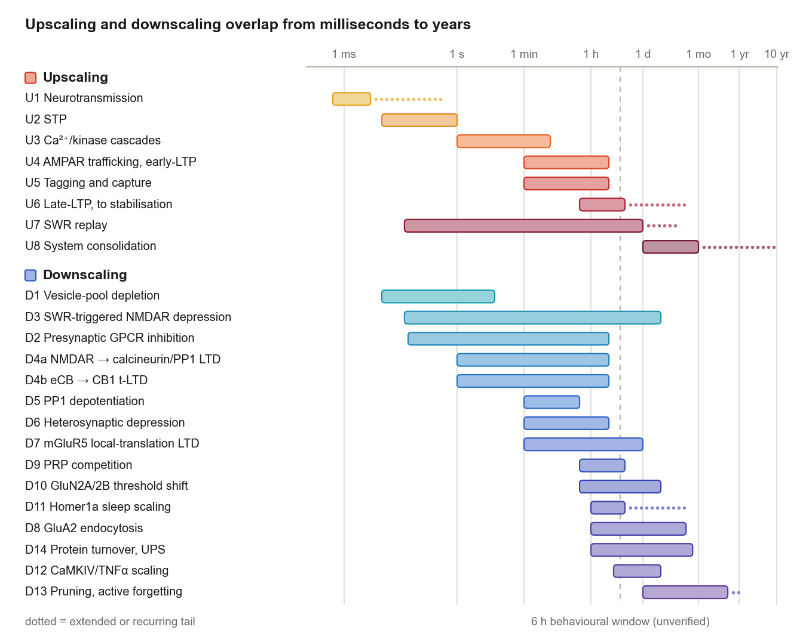
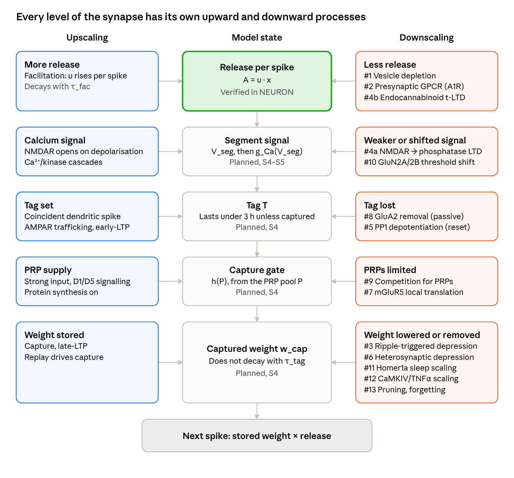

# Hippocampal plasticity in the NEURON model: upscaling and downscaling

Nov 6, 2026 · Max Talanov

## The main idea

In this model a synapse changes at three nested levels, and upscaling and downscaling act at each one. A change survives only if it passes from a fast level to a slower one.

- **Release (ms to s).** Each spike releases a fraction of the available resources. Facilitation raises that fraction; vesicle depletion and presynaptic inhibition lower it. The stored weight does not change.
- **Tag (minutes to hours).** Coincident activity sets a local tag, graded by NMDA-receptor calcium signalling in the dendritic segment. The tag decays unless it is captured.
- **Stored weight (hours and longer).** Capture needs both a tag and plasticity-related proteins (PRPs). In the model, captured weight no longer decays with the tag, and slower processes can later scale it down or remove it.

The hypothesis is that weakening also selects: what is captured and replayed is kept, and the rest fades or is depressed. Tag and capture are the candidate synaptic correlate of cellular consolidation, not an established identity.

The model is one CA1 pyramidal cell with one PV basket, one bistratified and one O-LM interneuron, in NEURON, in real units with no time compression. Only the release level is implemented and verified so far. The tag and capture levels are specified but not built, and most slow downscaling pathways are a literature map for later stages.

## Acronyms and abbreviations

Cell and pathway names match the [status report of November 2026](report_2026-11-06.md). Symbols are defined in the equations where they appear.

| Term | Meaning |
| --- | --- |
| A1R | Adenosine A1 receptor |
| AMPA, AMPAR | α-amino-3-hydroxy-5-methyl-4-isoxazolepropionic acid; its receptor |
| Arc | Activity-regulated cytoskeleton-associated protein |
| BCM | Bienenstock–Cooper–Munro rule with a sliding threshold |
| BiS | Bistratified interneuron |
| C1q, C3, CR3 | Complement components 1q and 3; complement receptor 3 |
| CA1, CA3 | Cornu Ammonis areas 1 and 3 |
| CaMKII, CaMKIV | Ca²⁺/calmodulin-dependent protein kinases II and IV |
| CB1 | Cannabinoid receptor type 1 |
| D1–D14 | Downscaling pathways, numbered as in Table 2; D4 has parts a and b |
| E3 | Ubiquitin ligase, the enzyme that attaches ubiquitin to a target protein |
| eCB | Endocannabinoid |
| E-LTP, L-LTP | Early and late long-term potentiation |
| E/I | Excitation/inhibition |
| FMRP | Fragile X messenger ribonucleoprotein |
| GABA_A, GABA_B | γ-aminobutyric acid receptors, types A and B |
| GluA1, GluA2 | AMPA receptor subunits |
| GluN2A, GluN2B | NMDA receptor subunits |
| GPCR | G-protein-coupled receptor |
| IP3R | Inositol trisphosphate receptor |
| LFS | Low-frequency stimulation |
| LTD, t-LTD | Long-term depression; spike-timing-dependent LTD |
| LTP | Long-term potentiation |
| mGluR | Metabotropic glutamate receptor |
| NMDA, NMDAR | N-methyl-D-aspartate; its receptor |
| NREM, REM | Non-rapid and rapid eye movement sleep |
| O-LM | Oriens-lacunosum moleculare interneuron |
| P_r | Release probability |
| PKA | Protein kinase A |
| PP1 | Protein phosphatase 1 |
| PRP | Plasticity-related protein |
| PSD, PSD-95 | Postsynaptic density; its scaffold protein of 95 kDa |
| PV | Parvalbumin-positive basket interneuron |
| PYR | CA1 pyramidal cell |
| S0–S7 | Project stages in the plan |
| SC | Schaffer collaterals |
| SHY | Synaptic homeostasis hypothesis |
| SLM, SO, SR | Strata lacunosum-moleculare, oriens and radiatum |
| STDP | Spike-timing-dependent plasticity |
| STEP | Striatal-enriched protein tyrosine phosphatase |
| STP | Short-term plasticity |
| SWR | Sharp-wave ripple |
| T | Tag variable; also the tagged input pathway when written "T pathway" |
| TM | Tsodyks–Markram synapse model |
| TNFα | Tumour necrosis factor alpha |
| U1–U8 | Upscaling processes, numbered as in Table 1 |
| UPS | Ubiquitin–proteasome system |
| VGCC | Voltage-gated calcium channel |

## Timescales

The processes run from milliseconds to years, and they overlap instead of handing off in sequence. Upscaling and downscaling coexist from about 10 ms to months, so no level of the synapse has only one direction (Figure 1).



**Figure 1.** All upscaling and downscaling processes on one logarithmic time axis: 8 upscaling (hot colours, amber to crimson) and 15 downscaling (cold colours, teal to violet), one colour per process. Downscaling rows are sorted by onset, then by end. Dotted tails mark NMDA deactivation (U1), persistence after stabilisation (U6), recurring replay (U7), the human range of system consolidation (U8), and recurring or extended effects (D11, D13). Spans, tails and colours are shared with the two figures in the repository root's documents (`plasticity_timescales.py`). Bars are order-of-magnitude summaries of the two source documents, not fitted values. Where a source gives only "hours" or "days", the bar's end is our rounding. Figures 1 and 2 are drawn by `make_fig_plasticity_overview.py`.

**Two meanings of "consolidation".** This document always says which one it means.

- **Cellular consolidation:** for hours after learning, blocking protein or mRNA synthesis can prevent long-term memory. It happens locally in each region that stores the memory. Our 6 h figure comes from a personal communication (Edu, a hippocampal neuroscientist). Published rodent studies show discrete sensitive periods rather than one continuous window: around training and again about 3–6 h later (Igaz 2002), with a pattern that depends on training strength (Bourtchouladze 1998). A further phase at 12 h supports persistence (Bekinschtein 2007), and reactivated memories can become labile again (Nader 2000).
- **System consolidation:** over days to weeks in rodents and longer in humans, a memory stops depending on the hippocampus. This shows loss of dependence, not that the trace has left the hippocampus.

Late-LTP has two separate times: about 4–8 h until it stabilises, then days or longer of persistence. The slice late-LTP window and the 6 h behavioural window need not coincide, so every comparison must state which one it uses.

## Upscaling: from one spike to a lasting weight

Upscaling is a chain of eight processes (Table 1). Of these, only STP (U2) is implemented as plasticity so far. The NEURON model will reach as far as late-LTP, and replay enters only as an imposed input.

**Table 1.** The eight upscaling processes, from fastest to slowest, with their terms in the model and their status.

| # | Process | Timescale | What it does | Term in the model | Status |
| --- | --- | --- | --- | --- | --- |
| U1 | Neurotransmission | AMPA ms; NMDA hundreds of ms | Receptor gating carries each synaptic event | AMPA and GABA_A conductances | AMPA and GABA_A run; NMDA planned |
| U2 | STP | 10 ms–1 s | Each spike raises the release fraction u | u in `TMSyn` | Verified |
| U3 | Ca²⁺/kinase cascades | 1 s–5 min | Decides whether a weight update happens | Lumped into g_Ca(V_seg); no explicit kinase | Planned, S4–S5 |
| U4 | AMPAR trafficking, early-LTP | 1–30 min, decays over 1–3 h | Adds receptors, independent of protein synthesis, and fades | Carried by the tag T in the plan; see limits | Planned, S4 |
| U5 | Synaptic tagging and capture | Set during induction; tag lasts under 3 h | A local tag is captured if PRPs arrive before it decays | T, P, h(P) in `SegTag` | Planned, S4 |
| U6 | Transcription, late-LTP | Onset 30–60 min; stable by 4–8 h | The potentiated state stops decaying | w_cap | Planned, S4 |
| U7 | SWR replay | Ripple about 40–100 ms; recurs over hours to days | Repeated events drive capture | Imposed sharp-wave-like input, not emergent | Planned, S4 |
| U8 | System consolidation | Days to years | Memory stops depending on the hippocampus | None | Out of scope |

**Release level (U2).** At spike n, with u the utilisation and x the available resources:

```math
u_n^+ = u_n^- + U(1 - u_n^-), \quad A_n = u_n^+ x_n^-, \quad x_n^+ = x_n^-(1 - u_n^+) \qquad (1)
```

Between spikes u decays to 0 with τ_fac and x recovers to 1 with τ_rec. The conductance step is w · A_n.

**Tag amplitude (U3).** One continuous state per dendritic segment leakily integrates its synaptic input. A sigmoid patterned on the NMDAR unblock curve turns it into an induction amplitude, so induction strength is graded rather than all-or-nothing.

```math
\tau_v \frac{dV_{seg}}{dt} = -V_{seg} + \sum_i w_i s_i(t), \qquad g_{Ca}(V_{seg}) = \frac{1}{1 + K e^{-\lambda V_{seg}}} \qquad (2)
```

Here τ_v is 10–30 ms. Because V_seg is shared on a segment, several subthreshold synapses can together reach the steep part of g_Ca. Here K is the sigmoid constant, not the contact count used in the circuit.

**Tag, PRP pool and capture (U4–U6).** A coincident event with a dendritic spike adds g_Ca(V_seg) to the tag. Somatic bursts add ΔP · s(t) to the PRP pool, where s is the protein-synthesis gate, 0 or 1.

```math
\frac{dP}{dt} = -\frac{P}{\tau_P}, \qquad h(P) = \frac{P^{n_H}}{P^{n_H} + \theta_{PRP}^{n_H}} \qquad (3)
```

```math
\frac{dT}{dt} = -\frac{T}{\tau_{tag}} - k_{cap}\, h(P)\, T, \qquad \frac{dw_{cap}}{dt} = k_{cap}\, h(P)\, T \qquad (4)
```

Capture is gradual by design. The protein-synthesis-sensitive window is therefore an output of the model, not an input. Instantaneous capture is the limit of large k_cap and n_H, kept for comparison. Here n_H is the Hill exponent, written n in the plan. k_cap, n_H and τ_P have no source and will be swept, not tuned to give 6 h.

## Downscaling: fifteen pathways that weaken or bound a synapse

Downscaling is not one process. We list 15 molecular pathways (Table 2), each described by what senses the trigger and what physically weakens the synapse. Two of them are implemented: depletion in the circuit, and A1R inhibition as a verified mechanism not yet wired in.

Rules such as STDP, BCM or firing-rate homeostasis are a separate level: they say which activity pattern changes a weight, not how. One rule can use several pathways, and one pathway can serve several rules. So only sensors and effectors become mechanisms; a rule is what a mechanism must reproduce, which makes it an acceptance test.

**Table 2.** The fifteen downscaling pathways, sorted by onset: site, timescale, sensor and effector, rule, term in the model, status, and how well the pathway is supported in the healthy adult hippocampus. The last column is explained, with evidence, in the plausibility section of `hippocampal_downscaling_mechanisms.md`: established, likely (mature but not adult), conditional (adult, but only in a given state, protocol or area), uncertain, or developmental (lost in adults).

| Pathway (site) | Timescale | Sensor → effector | Rule | Term in the model | Status | Healthy adult hippocampus |
| --- | --- | --- | --- | --- | --- | --- |
| D1 Vesicle-pool depletion (pre) | 10 ms–10 s | Spike and VGCC Ca²⁺ → readily releasable pool depleted | Frequency-dependent depression | x in `TMSyn` | Verified, in circuit | Established |
| D3 SWR-triggered NMDAR depression (post) | Ripple about 40–100 ms; effect lasts hours | NMDAR during SWR → AMPAR weakening (effector unresolved) | Offline depression | Stored weight of non-replayed inputs | Candidate | Conditional |
| D2 Presynaptic GPCR inhibition (pre) | 50 ms–min; tonic over hours | A1R, GABA_B, group II/III mGluR → lower P_r | Tonic and neuromodulatory gain | U_eff in `TMSynPI` | A1R verified, not in circuit | Established |
| D4a NMDAR → calcineurin/PP1 LTD (post) | Induction s–min; expression hours | Moderate NMDAR Ca²⁺ → GluA1-S845 dephosphorylation, AMPAR endocytosis | Rate-dependent LTD | Low-Ca branch of g_Ca | Candidate | Conditional |
| D4b Endocannabinoid → CB1 t-LTD (pre, induced post) | Induction s–min; expression hours | Post mGluR and Ca²⁺ → eCB; pre CB1 and NMDAR → lower P_r | STDP depression | Reduction of U | Open: see limits | Developmental |
| D5 PP1 depotentiation (post) | Minutes to tens of minutes, by protocol | LFS, NMDAR Ca²⁺ and A1R → PP1 reverses phosphorylation | Reversal of recent LTP | Active reset of T | Candidate | Established |
| D6 IP3R/calcineurin heterosynaptic depression (post, unstimulated) | Min–hours | Neighbour potentiation, group I mGluR, IP3R Ca²⁺ → inactive spines shrink | Heterosynaptic normalisation | Conservation per segment | Candidate | Uncertain |
| D7 mGluR5 → local-translation LTD (post) | Min–1 day | Group I mGluR → Arc, STEP, MAP1B translation, AMPAR endocytosis | Protein-synthesis-dependent LTD | Draws on the PRP machinery | Deferred | Likely |
| D9 PRP competition (post; extent of the pool debated) | 30 min–8 h | No sensor: finite pool, synthesis against degradation | Competition between inputs | Shared capture resource | Not in the equations yet | Conditional |
| D10 GluN2A/2B threshold shift (post) | 30 min–days | Activity history → subunit ratio changes | BCM sliding threshold | Moves θ_p of g_Ca | Candidate | Conditional |
| D11 Homer1a–mGluR5 sleep scaling (post) | Hours, each sleep cycle | Sleep state → Homer1a → GluA1 dephosphorylation, AMPAR removal | SHY | Global step between replay epochs | Deferred | Conditional |
| D8 Constitutive GluA2 endocytosis (post) | Early-LTP under 3 h; also erodes established memory over weeks | No sensor: absence of capture → inserted AMPARs removed | Decay of unconsolidated LTP | τ_tag | Planned, S4 | Established |
| D14 Ubiquitin–proteasome degradation and protein turnover (post; also the PRP pool) | Hours (activity-driven) to days–weeks (basal turnover) | NMDAR Ca²⁺ or sustained activity → E3 ligases (e.g. Mdm2) ubiquitinate PSD proteins → proteasome; basal turnover has no sensor | Homeostatic PSD remodelling; contribution to LTD; loss of unmaintained weight | Turnover and maintenance of w_cap; degraded constraint on capture | Candidate; LTD evidence conflicting | Established / uncertain |
| D12 CaMKIV/TNFα synaptic scaling (post; also P_r) | Hours to days | Somatic Ca²⁺, glial TNFα → multiplicative AMPAR change | Firing-rate homeostasis | Multiplicative factor on weights | Candidate, needs stated compression | Uncertain |
| D13 Complement pruning, Rac1/cofilin (whole synapse) | Days–months | C1q/C3 at weak synapses → microglial removal; actin disassembly | Structural forgetting | Removal of uncaptured traces | Deferred | Established |

"Candidate" means proposed for after S4–S6, in this order: D8 and D5, D4a and D10, D6, D3, D12. Nothing in this group is built yet.

The sections below group the pathways by the model state they act on, in the same order as Figure 2. Release-level equations are implemented and verified. Equations marked "proposed" are our suggested forms: they are not in the plan, and their parameters have no source yet.

### Release: less transmitter per spike

These pathways lower release, not the stored weight. The fast ones recover on their own, and all of them act through x or U.

**D1 Vesicle-pool depletion.** Each release uses part of the readily releasable pool, so later responses in a train shrink until the pool recovers. Single hippocampal release sites have small pools, about 5 quanta on average (Dobrunz & Stevens 1997). The model represents this with x, the available resources. It does not include receptor desensitisation or release-site refractoriness.

```math
x_n^+ = x_n^-(1 - u_n^+), \qquad \frac{dx}{dt} = \frac{1 - x}{\tau_{rec}} \qquad (5)
```

τ_rec ranges from 138 to 1250 ms across our pathways, so inhibitory synapses onto PYR recover most slowly.

**D2 Presynaptic GPCR inhibition.** A1R, GABA_B and group II/III mGluRs lower release probability through G-protein inhibition of calcium channels and the release machinery. Adenosine acts in two ways: a tonic level, and a phasic rise released by activity (Mitchell, Lupica & Dunwiddie 1993). `TMSynPI` implements both for A1R:

```math
U_{eff} = U\,(1 - i_{tonic})\,(1 - I(t)), \qquad I(t) = i_{max}\left(1 - e^{-D(t)}\right) \qquad (6)
```

In `TMSynPI`, U_eff replaces U in Eq. 1. D(t) sums a double-exponential term for each SC volley, after a 50 ms lag. From Mitchell et al. (rat, 34 °C, 2.5 mM Ca, SC fEPSP): i_tonic = 0.15, i_max = 0.40 as a lower bound, and c = 0.315 per volley. The rise and decay constants, 168 and 176 ms, were fitted to that paper's time course. At this drive SC→PYR loses its net upscaling window. For GABA_B we have only a maximum effect, so it does not run.

**D4b Endocannabinoid → CB1 t-LTD.** When a postsynaptic spike precedes a presynaptic one, postsynaptic calcium and group I mGluR drive endocannabinoid synthesis. Retrograde CB1 activation, together with presynaptic NMDARs, then lowers release (Sjöström 2003, neocortical layer 5). At mouse CA3→CA1 synapses at P12–P18, this form also needs IP3R calcium release, astrocyte signalling and presynaptic calcineurin (Andrade-Talavera 2016). It is lost in the fourth postnatal week but returns when A1Rs are blocked (Pérez-Rodríguez 2019), which links it to D2. Because expression is presynaptic, the proposed form scales U:

```math
U \rightarrow U\,(1 - d_{tLTD}) \quad \text{(proposed)} \qquad (7)
```

### Segment signal: the same calcium can mean depression

These pathways decide the sign of a change. They do not exist in the current plan, which has one sigmoid and can only set a tag.

**D4a NMDAR → calcineurin/PP1 LTD.** Modest, prolonged NMDAR calcium favours phosphatases over kinases. Calcineurin inactivates inhibitor-1, which frees PP1 (Mulkey 1994). GluA1 is then dephosphorylated and AMPARs are removed by endocytosis. In rat CA1, 900 pulses at 1–3 Hz depress responses for over 1 h, while the same pulses at 50 Hz usually potentiate (Dudek & Bear 1992). This LTD is input-specific and needs postsynaptic calcium (Mulkey & Malenka 1992). The site dephosphorylated depends on history: the PKA site in naive synapses, the CaMKII site in potentiated ones (Lee 2000). The calcium-control hypothesis reduces this to two thresholds (Lisman 1989; Shouval 2002):

```math
\text{outcome}(Ca) = \begin{cases} \text{no change} & Ca < \theta_d \\ \text{depression} & \theta_d \le Ca < \theta_p \\ \text{tag} & Ca \ge \theta_p \end{cases} \quad \text{(proposed)} \qquad (8)
```

Here Ca is the segment calcium signal g_Ca(V_seg) of Eq. 2. Eq. 8 would replace the current rule, in which every coincident event adds g_Ca to the tag. It covers rate dependence only; timing-dependent depression is D4b.

**D10 GluN2A/2B threshold shift.** The LTD/LTP crossover moves with recent activity: high activity raises θ_p and favours depression, and low activity lowers it. BCM is the rule (Bienenstock, Cooper & Munro 1982), and NMDAR subunit composition is one possible substrate. In rat visual cortex, experience reduces NR2B-only receptors and shortens NMDAR currents within hours, while deprivation reverses this over days (Philpot 2001). We have no CA1 source yet. The proposed form adds one slow state per segment, driven by the time-averaged calcium signal:

```math
\tau_\theta \frac{d\theta_p}{dt} = \theta_0 + \beta\,\bar{g}_{Ca} - \theta_p \quad \text{(proposed)} \qquad (9)
```

### Tag: losing the label before capture

The tag can be lost in two ways: passively, or by an active reset. The first is built into the plan; the second would give the capture test a second falsification arm.

**D8 Constitutive GluA2 endocytosis.** No sensor is needed. Without capture, AMPAR endocytosis removes the added receptors, and blocking this endocytosis converts decaying LTP into non-decaying LTP (Dong 2015). In the plan this is the decay term −T/τ_tag of Eq. 4. The process does not stop at the tag: blocking GluA2 removal with interference peptides prevents forgetting of established memories in rats (Migues 2016). The plan does not include that slower action on captured weight.

**D5 PP1 depotentiation.** Low-frequency stimulation soon after LTP induction reverses it, through NMDARs and protein phosphatases (O'Dell & Kandel 1994). The window depends on protocol and preparation:

- **Rat slices, 2 Hz for 10 min:** effective at 3 min or less, not at 10 min. It needs A1R, which ties it to D2 (Huang 1999).
- **Adult rats in vivo, 1 Hz then 5 Hz:** given 5–15 min after LTP, it reversed potentiation for the 1 h test in 64% of animals (Staubli & Lynch 1990).
- **Guinea pig slices, 1 Hz for 1000 pulses:** given at 20 min, it reduced the potentiated EPSP slope by 68.5%, with less effect at 100 min (Fujii 1991).

A reset also removes the tag itself: stimulation 5 min after induction prevented any lasting LTP (Sajikumar & Frey 2004). The proposed form is an event on T:

```math
T \rightarrow \rho\,T, \quad 0 \le \rho < 1, \quad \text{if LFS arrives within } t_w \text{ of induction} \quad \text{(proposed)} \qquad (10)
```

### PRP pool: too little to capture everything

These pathways make capture a limited resource instead of an independent gate at each synapse.

**D9 PRP competition.** Under reduced protein synthesis, new protein-synthesis-dependent LTP on one pathway occurs at the expense of maintaining earlier LTP on another (Fonseca 2004). Synthesis is not the only factor: blocking proteasomal degradation also disrupts late-LTP, and blocking both restores it (Fonseca 2006). The planned equations (Eqs. 3 and 4) cannot show competition, because capture never consumes P. The proposed form shares P within a compartment and adds consumption over its tagged groups j:

```math
\frac{dP}{dt} = -\frac{P}{\tau_P} - \gamma \sum_j k_{cap}\, h(P)\, T_j \quad \text{(proposed)} \qquad (11)
```

**D7 mGluR5 → local-translation LTD.** Group I mGluR activation triggers local protein synthesis in dendrites that changes transmission within minutes (Huber 2000). Rapid Arc translation raises the AMPAR endocytosis rate for a long time, and this LTD needs Arc; NMDAR-LTD does not (Waung 2008). The two LTD forms coexist in juvenile rat CA1 and are mechanistically distinct (Oliet 1997). That paper found reduced event frequency with no change in quantal size for mGluR-LTD, so its expression site is not settled by the abstracts we read. Our link to capture, that it competes for the same translation machinery, is a hypothesis. We propose no equation until the sign of change and the LTD tag are decided.

### Stored weight: lowering or removing what was kept

These pathways act on the stored weight, mostly offline and over hours or longer. All of them are outside the current plan, and the slower ones would need a stated compression factor in any short run. In Eqs. 12–15, w is the stored weight of one synapse, w_0 + α · w_cap in Eq. 18. How a change divides between those two terms is not specified yet.

**D3 SWR-triggered NMDAR depression.** In mice, sharp-wave ripples trigger long-lasting, NMDAR-dependent depression selective for one input pathway. Silencing ripples during slow-wave states prevented the down-regulation of net synaptic weights and impaired new learning (Norimoto 2018). The downstream effector is not resolved. CA1 firing in rats falls 11% per hour across sleep, and spindle and ripple incidence predict the change (Miyawaki & Diba 2016). In mouse cortex, Up states bias plasticity towards depression of inputs that do not drive the cell (González-Rueda 2018). The proposed form applies per ripple to inputs not replayed:

```math
w_j \rightarrow w_j\,(1 - \delta_{SWR}), \quad j \notin \text{replayed} \quad \text{(proposed)} \qquad (12)
```

**D6 IP3R/calcineurin heterosynaptic depression.** Potentiating several neighbouring spines on a CA1 dendrite shrinks and weakens nearby unstimulated ones. Blocking calcineurin, IP3Rs or group I mGluRs stops this shrinkage but not the potentiation, which points to an active signal rather than competition for structural resources (Oh 2015). In amygdala intercalated neurons, opposite heterosynaptic changes keep total weight nearly constant (Royer & Paré 2003); we have no such measurement for CA1. The proposed form spreads the potentiation over the N_inact inactive synapses of the same segment, once enough neighbours have potentiated:

```math
\Delta w_j = -\frac{\eta}{N_{inact}} \sum_{i\ \text{potentiated}} \Delta w_i \quad \text{(proposed)} \qquad (13)
```

**D11 Homer1a–mGluR5 sleep scaling.** During sleep in mice, synapses lose and dephosphorylate AMPARs, driven by Homer1a and group I mGluR signalling. Noradrenaline and adenosine link this to arousal and sleep need (Diering 2017). In rat cortex and hippocampus, GluA1-containing AMPAR levels are high in wake and low in sleep (Vyazovskiy 2008). In mouse cortex the axon–spine interface shrinks about 18% after sleep in proportion to its size, but large synapses are spared (de Vivo 2017). So the scaling is not uniform. REM sleep in mouse motor cortex both prunes and strengthens new spines (Li 2017). The proposed form is one step per sleep cycle, excluding a spared set:

```math
w_j \rightarrow w_j\,(1 - \varepsilon_{sleep}), \quad j \notin \text{spared} \quad \text{(proposed)} \qquad (14)
```

**D12 CaMKIV/TNFα synaptic scaling.** Sustained changes in firing scale all of a neuron's excitatory synapses up or down (Turrigiano 1998). Reduced somatic calcium lowers CaMKIV activation and increases transcription (Ibata 2008); glial TNFα and Arc-driven AMPAR endocytosis also contribute (Stellwagen & Malenka 2006; Shepherd 2006). Most of this evidence comes from culture, and much of it is scaling up after silencing. In hippocampal organotypic cultures the response is synapse-specific: CA3→CA1 goes up, and recurrent CA3→CA3 goes down (Kim & Tsien 2008). Local dendritic activity also sets release probability (Branco 2008), so a presynaptic term would scale U. The proposed postsynaptic form, with r the firing rate and r\* its target, is:

```math
\tau_s \frac{dw_i}{dt} = w_i\,\frac{r^* - r}{r^*} \quad \text{(proposed)} \qquad (15)
```

**D13 Complement pruning and Rac1/cofilin forgetting.** Over long periods, whole synapses are removed. In adult mouse hippocampus, microglia engulf synaptic components, and depleting microglia or inhibiting complement in engram cells prevents forgetting (Wang 2020). Rac-dependent forgetting was first shown in *Drosophila* (Shuai 2010). Dentate neurogenesis also causes forgetting (Akers 2014), but it lies outside our CA1 circuit. We propose no equation: this pathway ends the life of a trace, far beyond any planned run.

### Turnover: the parts of a synapse are replaced

**D14 Ubiquitin–proteasome degradation and protein turnover.** This pathway has two parts. Both act on molecules rather than on a signal, so they belong to every stored state, not to one input.

*Basal turnover.* The proteins that hold a stored weight do not last as long as the memory. In rat hippocampal cultures, protein half-lives range from under a day to more than 20 days (Dörrbaum 2018). In mouse synapses a set of long-lived proteins persists for weeks or longer, and synaptic proteins in general turn over more slowly than cytosolic ones (Heo 2018). A weight can therefore outlast its molecules only if something rebuilds it, which is Crick's (1984) turnover problem. The candidate answers are a self-maintaining kinase switch (Lisman 1985; Miller 2005) and recurring protein synthesis, such as the phase at 12 h after training (Bekinschtein 2007). Eq. 4 keeps captured weight forever, so it silently assumes perfect maintenance. Without maintenance, turnover is a slow downscaling pathway in its own right. The proposed form adds turnover with time constant τ_turn and an optional maintenance term to Eq. 4:

```math
\frac{dw_{cap}}{dt} = k_{cap}\, h(P)\, T - \frac{w_{cap}}{\tau_{turn}} + k_m\, s_m(t)\, \frac{w_{cap}^{n_m}}{w_{cap}^{n_m} + \theta_m^{n_m}} \quad \text{(proposed)} \qquad (16)
```

Here s_m is a maintenance-synthesis gate, 0 or 1. With k_m = 0, captured weight decays with τ_turn. With k_m > 0 and n_m > 1, the equation is bistable: a weight above θ_m is held, and one below it decays. Blocking s_m should then erase only weights that have not yet reached the stable branch. τ_turn, k_m, n_m and θ_m have no source. A τ_turn of days is far beyond any planned run, so it needs a stated compression factor or stays out.

*Activity-driven degradation.* In cultured rat hippocampal neurons, activity changes the composition of the postsynaptic density in both directions and reversibly, and this needs ubiquitination and proteasomal degradation (Ehlers 2003). This gives homeostatic scaling (D12) a molecular effector. NMDAR activation leads the E3 ligase Mdm2 to ubiquitinate PSD-95, which is then degraded by the proteasome. Blocking this prevents NMDA-induced AMPAR endocytosis and reduces LTD (Colledge 2003), which would place the UPS inside D4a. The evidence conflicts: a later study found that proteasome inhibition left NMDAR-LTD unchanged and enhanced mGluR-LTD (Citri 2009). Meanwhile, FMRP made during mGluR-LTD is degraded by the proteasome, and proteasome inhibitors were reported to block that LTD (Hou 2006). Its role in D4a and D7 is therefore unsettled, and we propose no equation for it.

*Degradation is needed for late-LTP too.* Blocking proteasomal degradation disrupts late-LTP, and blocking synthesis and degradation together restores it (Fonseca 2006). Eq. 3 cannot reproduce this, because its −P/τ_P term only removes PRPs and so can only weaken capture. One way to reproduce it, which is our hypothesis, is a synthesised constraint R that the proteasome degrades and that opposes capture:

```math
\frac{dR}{dt} = r_{syn}\, s(t) - k_{UPS}\, R, \qquad k_{cap} \rightarrow \frac{k_{cap}}{1 + R/\theta_R} \quad \text{(proposed)} \qquad (17)
```

Blocking synthesis (s = 0) removes both P and R. Blocking the proteasome (k_UPS = 0) lets R build up and blocks capture. Blocking both leaves neither, so capture depends only on the P already present. Whether that restores late-LTP depends on P's own loss term, which is a test of the form, not a guarantee.

## How the processes combine

Each process acts on one term of a single chain, so their effects can be located and combined (Figure 2). Release multiplies the stored weight, the tag feeds the stored weight, and the PRP pool gates the transfer.



**Figure 2.** The chain of model states, with upscaling (red) and downscaling (blue) processes acting on each. Read down the middle for the chain, and across each row for what raises or lowers that state. Only the top state runs in NEURON today. D14 appears twice, because it acts on both P and w_cap.

Written as one expression, the amplitude of spike n is:

```math
\Delta g_n = \big[\,w_0 + \alpha\,\big(T(t_n) + w_{cap}(t_n)\big)\,\big] \cdot A_n \qquad (18)
```

Eq. 18 is our summary; the plan does not yet state it. α converts the unitless T and w_cap into a conductance, and its value has no source yet. Because Eq. 4 moves T into w_cap one-to-one, capture does not change the weight when it happens: it only stops that part from decaying. This assumes early-LTP and captured weight have equal strength per unit of T.

**1. Inside release, up and down terms add on a log scale.** We split each release exactly:

```math
\log\frac{A_n}{U} = \log\frac{u_n^+}{U_{eff}} + \log x_n^- + \log(1 - I_n) + \log(1 - i_{tonic}) \qquad (19)
```

The terms of Eq. 19 are facilitation, depletion, phasic A1R and tonic A1R. On the three facilitating pathways the net effect flips from up to down at a crossover rate f\*: 27.5 Hz for SC→PYR, 22.6 Hz for SC→PV and BiS, and 75.4 Hz for PYR→O-LM. Inhibitory synapses onto PYR are net down at every rate.

**2. The balance differs by pathway, so STP reshapes E/I.** At a steady 20 Hz, the net factors are ×1.15 for SC→PYR, ×2.77 for PYR→O-LM, ×0.25 for PV→PYR, ×0.26 for BiS→PYR and ×0.12 for O-LM→PYR. Adding A1R inhibition turns SC→PYR to ×0.86. These are single-synapse values; the implied tilt towards excitation is a prediction for the circuit, not a result.

**3. Presynaptic gain acts at theta and gamma rates, not at ripple rates.** A gain of 0.5–1.5× on U moves f\* for SC→PYR from 66 to 14 Hz. At 200 Hz, steady-state release stays at 0.026 for every gain, because τ_rec sets it there.

**4. Release feeds induction.** S3e will test what the tag reads from STP: per-event u · x and w · u · x. If tag amplitude follows B(f), the steady-state release relative to the first spike, then fast release dynamics decide which rates can set a tag.

**5. Calcium could set the sign.** With two thresholds (Eq. 8), θ_d ≤ Ca < θ_p gives depression (D4a) and Ca ≥ θ_p gives a tag. Recent activity moves θ_p (D10; Eq. 9), so history changes the sign of the next change. The current plan has one sigmoid; two thresholds are a candidate extension.

**6. A tag has three possible fates.** It is captured, it decays passively through AMPAR endocytosis (D8; Dong 2015), or low-frequency stimulation resets it soon after induction (D5). Reported windows run from 3 min or less (Huang 1999) to at least 20 min (Fujii 1991), depending on protocol and preparation. A reset tag can no longer capture PRPs, and stabilised late-LTP no longer reverses.

**7. The PRP pool links nearby synapses.** A strong input can supply PRPs for a weak input's tag, which is the Frey–Morris design. The original hypothesis made the pool cell-wide, but later work confines tagging and capture to dendritic compartments or branches (Sajikumar 2007, 2011; Govindarajan 2011). With limited synthesis, inputs compete (D9), and protein-synthesis-dependent LTD (D7) draws on the same machinery. Late-LTP also depends on protein degradation: blocking synthesis and degradation together restores it (Fonseca 2006). The same ubiquitin–proteasome system removes PSD proteins after NMDAR activation and during homeostatic remodelling (D14), so it acts on both sides of the balance.

**8. Replay may select as well as store.** The same ripple could capture what is replayed and depress the rest (D3). Sleep (D11) and homeostatic scaling (D12) then lower total weight, and scaling preserves relative weights because it is multiplicative. Synapses that remain weak can be removed (D13). Each part has evidence: reactivated firing with ripple input induces LTP in rat slices (Sadowski 2016), and ripples trigger NMDAR-dependent depression in mice (Norimoto 2018). That replay content selects between them, and this whole sequence, is our hypothesis.

**9. Stability needs fast compensation.** Zenke & Gerstner 2017 argue that compensation must be comparable in speed to Hebbian growth, so slow scaling alone cannot stabilise it. Heterosynaptic depression (D6) is the candidate they name. We add D3 and D10 as candidates, though D10 may be too slow. Inside the STP stage, nothing limits potentiation except depletion and the inhibitory loop.

## What is in NEURON today

The release level runs in NEURON; everything slower is still specification (Table 3). Every mechanism must match an analytic or numpy reference before use, and the two written so far do.

**Table 3.** What is in NEURON, by milestone.

| Milestone | Levels covered | Mechanisms | State on 6 November 2026 |
| --- | --- | --- | --- |
| 1. STP, S0–S3 | Release, up to about 1 s, plus U gains set per run | `TMSyn`, `TMSynPI` | Single-synapse work done: `TMSyn` matches the closed form to 8e-14, and steady-state rates match to 3e-11. Cells calibrated to Bezaire et al. 2016 at 34 °C but not yet running in the circuit |
| 2. Tag and capture, S4–S6 | Segment signal, tag, PRP pool, captured weight | `SegTag`, NMDA with Mg²⁺ block, STDP step | Not started; none of these is written |
| After S4–S6 | Slower downscaling, D3 to D14 except D8 | Each a dataclass plus a `build_*` function | Candidates only |

The circuit has two spike generators, four cells and 11 projections, all with Tsodyks–Markram STP. Its only full run used placeholder cells, so it is a pilot and supports no PYR claim. The [status report of November 2026](report_2026-11-06.md) gives the projection table (its Table 1), cell fits (its Tables 2 and 3) and parameter sources (its Table 4).

## What the model predicts, and how each prediction is tested

The combined scheme makes predictions that can fail (Table 4). Only the first has been tested, and only at the single-synapse level.

**Table 4.** Predictions of the combined scheme, with their tests and current state.

| Prediction | Test | Stage | State |
| --- | --- | --- | --- |
| A U gain moves f\* but not the saturated high-rate release | NEURON clamp against the closed form | S3a | Holds on secondary-source parameters |
| The E/I conductance ratio rises during a volley, more with inhibitory STP on | SC volleys at 5, 20, 80 and 200 Hz; STP on or off; at least 5 seeds | S3c | Next, after synapse placement |
| Removing a depressing inhibitory pathway changes PYR output in the sign its B(f) predicts | Ablate PV, BiS or O-LM | S3c | Not run |
| Tag amplitude against rate follows B(f) | Pathway T, STP on and off | S3e | Not started |
| Blocking capture leaves the weight at baseline, while PYR spike times during pathway S volleys stay identical | Normal capture against blocked capture | S4 | Not started |
| Retained weight does not decrease as a protein-synthesis block starts later | Block at 0–8 h; report t₅₀ with its CI | S4 | Not started |
| Partial NMDAR block shrinks the captured weight continuously, not all-or-nothing | NMDAR conductance 0–100% | S5 | Not started |
| LFS inside the reset window abolishes capture | Add active reset (D5) as a second falsification arm | After S4–S6 | Candidate |
| Without maintenance, captured weight decays with τ_turn; with it, only weights below θ_m are lost when maintenance synthesis is blocked | Sweep τ_turn and k_m in Eq. 16; block s_m at 12 h | After S4–S6 | Candidate |
| Blocking synthesis and degradation together restores capture that either block alone prevents | Eq. 17 with s = 0, k_UPS = 0, and both | After S4–S6 | Candidate |

t₅₀, the half-retention time, is compared with the 6 h behavioural window, not fitted to it. The target is a whole-animal measure and the model is one CA1 synapse, so agreement would show consistency, not mechanism.

## Limits and known gaps

The scheme is a hypothesis built largely from secondary and partly unchecked sources, and its equations have known gaps. The main known gaps are listed here.

1. **Segment signal.** V_seg (Eq. 2) is an abstract leaky integral of synaptic input, although a biophysical cell already has local membrane voltage. The plan does not yet read voltage or NMDAR calcium directly.
2. **Tag and early-LTP.** The plan carries early-LTP in T. Redondo & Morris 2011 report that the tagged state and LTP expression are dissociable, so they may need separate states.
3. **One tag only.** Late-LTD is also tagged, and cross-tagging occurs (Sajikumar & Frey 2004). Tag molecules differ by process, with CaMKII for LTP and ERK1/2 for LTD in apical CA1 (Sajikumar 2007).
4. **PRP trigger.** The plan increments P on somatic bursts, which has no source. Evidence points to strong synaptic input and dopamine D1/D5 receptor signalling (Huang & Kandel 1995; Moncada & Viola 2007).
5. **PRP pool.** The plan builds one `SegTag` per tagged synapse group, and capture does not consume P. Competition (D9) needs a pool shared within a compartment and a consumption term.
6. **No upper bound.** Nothing in the planned equations saturates w_cap (Eq. 4), so repeated events can raise it without limit. LTP saturation is experimentally real (Moser 1998).
7. **Captured weight.** The planned model holds it stable, but GluA2 removal erodes established memories (Migues 2016), maintenance needs recurring protein synthesis (Bekinschtein 2007), and the proteins that hold it turn over in days to weeks (Dörrbaum 2018; Heo 2018). D14 proposes turnover and a maintenance term (Eq. 16); neither has values.
8. **Adult t-LTD.** Presynaptic t-LTD at mouse CA3→CA1 is lost in the fourth postnatal week (Pérez-Rodríguez 2019). Adult rat CA1 population data do show depression when post precedes pre by 20 ms (Pang 2019). The plan's ±20 ms depression lobe therefore has no settled adult mechanism. A presynaptic form would reduce U, not the postsynaptic weight.
9. **Sign of the change.** One sigmoid can only set a tag. Depression needs the two-threshold form (Eq. 8), and its thresholds have no CA1 values yet.
10. **Bistratified target.** The plan places BiS input on SR and SO; the circuit currently places it on SR only.
11. **Weight scale.** Eq. 18 uses one scale α for T and w_cap, which assumes early-LTP and captured weight have equal strength per unit of T. α has no source yet.

Other limits on the evidence:

- **Unsourced values:** α, k_cap, n_H, τ_P, K, λ and τ_v have no source and will be swept.
- **Mixed preparations:** cell targets are mouse and STP values are rat; two pathways use cortical values. Pathway D3 comes from mouse, D6's weight conservation from amygdala, Rac1 forgetting (D13) from *Drosophila*, and the GluN2A/2B data (D10) from rat visual cortex. Much LTD and t-LTD data come from juvenile animals. Rated for the healthy adult hippocampus (Table 2), six pathways are established, one likely, five conditional, two uncertain and one (D4b) developmental. The turnover and UPS data for D14 come mostly from cultured neurons.
- **Timespans:** the spans of the downscaling pathways are order-of-magnitude summaries, not fitted values.
- **Circuit size:** one PYR with contact-scaled projections cannot show population effects, ripple generation or replay ordering. Replay enters only as imposed input.
- **Slow pathways:** those running over days need a stated compression factor in any short run, or they stay out.

## Sources

This document combines `hippocampal_plasticity_model.md` and `hippocampal_downscaling_mechanisms.md`, with `docs/plan.md` and `docs/handoff.md`, from the repository [max-talanov/tinyHippo-bio-plasticity](https://github.com/max-talanov/tinyHippo-bio-plasticity). Numbers from simulations come from its `RESULTS.md`. Full references per pathway are in the downscaling document.

On 6 November 2026 all 84 journal references behind this document resolved correctly in PubMed. We compared the main claims with the abstracts, not the full texts, so details inside papers remain unchecked. Ripple duration comes from a [secondary source citing Buzsáki 2015](https://elifesciences.org/reviewed-preprints/106201v1), not from that review itself.

**Added during this check (PubMed abstracts):**

- Bekinschtein et al. 2007, *Neuron* 53:261. [PMID 17224407](https://pubmed.ncbi.nlm.nih.gov/17224407/)
- Bourtchouladze et al. 1998, *Learn Mem* 5:365. [PMID 10454361](https://pubmed.ncbi.nlm.nih.gov/10454361/)
- Dong et al. 2015, *J Clin Invest* 125:234. [PMID 25437879](https://pubmed.ncbi.nlm.nih.gov/25437879/)
- Govindarajan et al. 2011, *Neuron* 69:132. [PMID 21220104](https://pubmed.ncbi.nlm.nih.gov/21220104/)
- Huang & Kandel 1995, *PNAS* 92:2446. [PMID 7708662](https://pubmed.ncbi.nlm.nih.gov/7708662/)
- Igaz et al. 2002, *J Neurosci* 22:6781. [PMID 12151558](https://pubmed.ncbi.nlm.nih.gov/12151558/)
- Lester et al. 1990, *Nature* 346:565. [PMID 1974037](https://pubmed.ncbi.nlm.nih.gov/1974037/)
- Moncada & Viola 2007, *J Neurosci* 27:7476. [PMID 17626208](https://pubmed.ncbi.nlm.nih.gov/17626208/)
- Moser et al. 1998, *Science* 281:2038. [PMID 9748165](https://pubmed.ncbi.nlm.nih.gov/9748165/)
- Nader et al. 2000, *Nat Rev Neurosci* 1:216. [PMID 11257912](https://pubmed.ncbi.nlm.nih.gov/11257912/)
- Pang et al. 2019, *PNAS* 116:5737. [PMID 30819889](https://pubmed.ncbi.nlm.nih.gov/30819889/)
- Pérez-Rodríguez et al. 2019, *Cereb Cortex* 29:3266. [PMID 30169759](https://pubmed.ncbi.nlm.nih.gov/30169759/)
- Sadowski et al. 2016, *Cell Rep* 14:1916. [PMID 26904941](https://pubmed.ncbi.nlm.nih.gov/26904941/)
- Sajikumar et al. 2007, *J Neurosci* 27:5068. [PMID 17494693](https://pubmed.ncbi.nlm.nih.gov/17494693/)
- Sajikumar et al. 2011, *PNAS* 108:2551. [PMID 21248226](https://pubmed.ncbi.nlm.nih.gov/21248226/)

**Details checked against PubMed, PMC or publisher records, abstract level at most unless stated:**

- Norimoto et al. 2018, *Science* 359:1524. [doi:10.1126/science.aao0702](https://doi.org/10.1126/science.aao0702) (D3)
- Miyawaki & Diba 2016, *Curr Biol* 26:893 (D3)
- González-Rueda et al. 2018, *Neuron* 97:1244. [doi:10.1016/j.neuron.2018.01.047](https://doi.org/10.1016/j.neuron.2018.01.047) (D3, cortex)
- Lee et al. 2000, *Nature* 405:955. [doi:10.1038/35016089](https://doi.org/10.1038/35016089) (D4a)
- Sjöström et al. 2003, *Neuron* 39:641 (D4b, neocortex)
- Andrade-Talavera et al. 2016, *Cereb Cortex* 26:3637. [doi:10.1093/cercor/bhw172](https://doi.org/10.1093/cercor/bhw172) (D4b)
- Huang et al. 1999, *J Neurosci* 19:9728 (D5)
- Sajikumar & Frey 2004, *Neuroscience* 129:503. [doi:10.1016/j.neuroscience.2004.08.014](https://doi.org/10.1016/j.neuroscience.2004.08.014) (D5)
- Oh et al. 2015, *Cell Rep* 10:162. [doi:10.1016/j.celrep.2014.12.016](https://doi.org/10.1016/j.celrep.2014.12.016) (D6)
- Royer & Paré 2003, *Nature* 422:518. [doi:10.1038/nature01530](https://doi.org/10.1038/nature01530) (D6)
- Migues et al. 2016, *J Neurosci* 36:3481. [doi:10.1523/JNEUROSCI.3333-15.2016](https://doi.org/10.1523/JNEUROSCI.3333-15.2016) (D8)
- Fonseca et al. 2004, *Neuron* 44:1011. [doi:10.1016/j.neuron.2004.10.033](https://doi.org/10.1016/j.neuron.2004.10.033) (D9)
- Li et al. 2017, *Nat Neurosci* 20:427. [doi:10.1038/nn.4479](https://doi.org/10.1038/nn.4479) (D11, motor cortex)
- Ibata et al. 2008, *Neuron* 57:819 (D12)
- Kim & Tsien 2008, *Neuron* 58:925. [doi:10.1016/j.neuron.2008.05.009](https://doi.org/10.1016/j.neuron.2008.05.009) (D12)
- Branco et al. 2008, *Neuron* 59:475 (D12)
- Wang et al. 2020, *Science* 367:688. [doi:10.1126/science.aaz2288](https://doi.org/10.1126/science.aaz2288) (D13)
- Crick 1984, *Nature* 312:101 (D14; News and Views)
- Ehlers 2003, *Nat Neurosci* 6:231 (D14, cultured rat hippocampal neurons)
- Colledge et al. 2003, *Neuron* 40:595 (D14)
- Hou et al. 2006, *Neuron* 51:441 (D14; proteasome claim from a secondary excerpt)
- Dörrbaum et al. 2018, *eLife* 7:e34202. [doi:10.7554/eLife.34202](https://doi.org/10.7554/eLife.34202) (D14, rat hippocampal cultures)
- Heo et al. 2018, *PNAS* 115:E3827. [doi:10.1073/pnas.1720956115](https://doi.org/10.1073/pnas.1720956115) (D14, mouse)

- Dudek & Bear 1993, *J Neurosci* 13:2910 (D4a, age dependence)
- Manahan-Vaughan & Braunewell 1999, *PNAS* 96:8739 (D4a, adult in vivo)
- Xu, Anwyl & Rowan 1998, *Nature* 394:891. [doi:10.1038/29783](https://doi.org/10.1038/29783) (D5, adult in vivo)
- Nosyreva & Huber 2005, *J Neurosci* 25:2992 (D7, developmental switch)
- Abraham et al. 2001, *PNAS* 98:10924 (D10, adult dentate gyrus in vivo)

**Cited for D14 but not yet checked:** Citri et al. 2009, *Eur J Neurosci* (UPS and NMDAR- versus mGluR-LTD); Fonseca et al. 2006, *Neuron* 52:239; Lisman 1985, *PNAS* 82:3055; Miller et al. 2005, *PLoS Biol* 3:e107. The last two are in `docs/related_models.md` with their DOIs.

**Read for parameter values already in the code:**

- Bezaire et al. 2016, *eLife*: cell morphologies, channels and intrinsic targets.
- Ecker et al. 2019, bioRxiv [10.1101/716480](https://doi.org/10.1101/716480): STP and peak conductances.
- Wierenga & Wadman 2003, read only through the Hippocampus Hub data page: SC STP.
- Mitchell, Lupica & Dunwiddie 1993, *J Neurosci* 13:3439: A1R inhibition.

**Other standard citations, resolved in PubMed, abstract level at most:** Frey & Morris 1997; Redondo & Morris 2011; Jahr & Stevens 1990; Lisman 1989; Shouval, Bear & Cooper 2002; Clopath et al. 2010; Clopath et al. 2008; Barrett et al. 2009; Tsodyks & Markram 1997; Zenke & Gerstner 2017. Any parameter taken from these must first be read from the source and recorded with its conditions.
