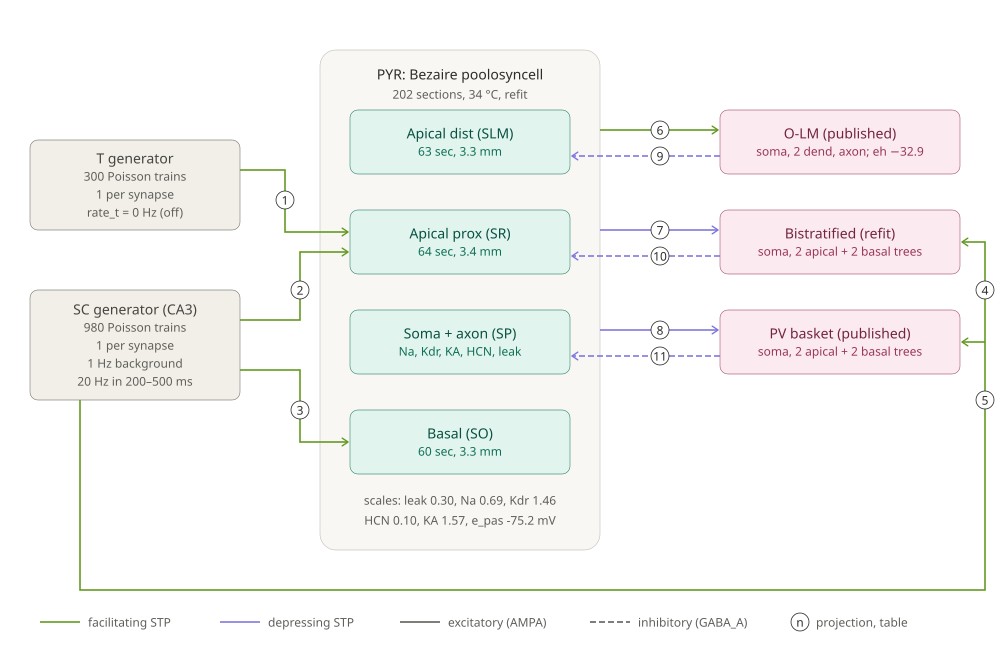
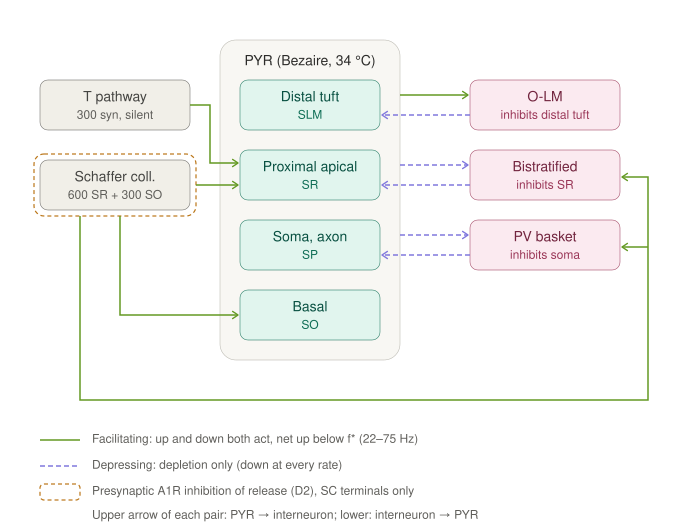
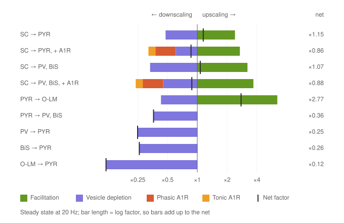

# CA1 Tier-B STP testbed: model, status and known gaps

Nov 5, 2026 · Max Talanov

## Acronyms and abbreviations

Cell-type labels differ between sources: this report uses PYR, PV and BiS, while Ecker et al. 2019 uses PC, PVBC and BS for the same cells. Other symbols (U, τ_rec, ĝ, K, f\* and so on) are defined where they are used.

| Term | Meaning |
| --- | --- |
| A1R | Adenosine A1 receptor |
| AHP | Afterhyperpolarisation |
| AMPA | α-amino-3-hydroxy-5-methyl-4-isoxazolepropionic acid (receptor) |
| BiS | Bistratified interneuron |
| BS | Bistratified cell (label in Ecker et al. 2019) |
| CA1, CA3 | Cornu Ammonis areas 1 and 3 of the hippocampus |
| \[Ca²⁺\]ₒ | Extracellular calcium concentration |
| CavL, CavN | L-type and N-type calcium channels |
| CI | Confidence interval |
| CVODE | Variable-step ODE solver used by NEURON |
| D, F | Depressing and facilitating synapse class |
| E/I | Excitation/inhibition |
| E1, E2, I2 | Ecker et al. 2019 synapse classes: excitatory facilitating, excitatory depressing, inhibitory depressing |
| EPSP, fEPSP | Excitatory postsynaptic potential; field EPSP |
| f–I | Firing rate against injected current |
| GABA_A, GABA_B | γ-aminobutyric acid receptors, types A and B |
| HCN | Hyperpolarisation-activated cyclic-nucleotide-gated channel; carries Ih |
| hh | Hodgkin–Huxley mechanism built into NEURON |
| Ih | Hyperpolarisation-activated current |
| ISI | Interspike interval in the cell fits; inter-stimulus interval in the paired-pulse test |
| KA, KvA | A-type potassium channel |
| KCaS | Calcium-activated potassium channel, not voltage dependent |
| Kdr | Delayed-rectifier potassium channel |
| KvCaB | Calcium-activated potassium channel, voltage dependent |
| NetCon | NEURON's network connection object |
| NMDA | N-methyl-D-aspartate (receptor) |
| NMODL | NEURON's language for describing mechanisms |
| O-LM | Oriens-lacunosum moleculare interneuron |
| PC | Pyramidal cell (label in Ecker et al. 2019) |
| PPR | Paired-pulse ratio |
| PRP | Plasticity-related protein |
| PV | Parvalbumin-positive basket interneuron |
| PVBC | PV basket cell (label in Ecker et al. 2019) |
| PYR | CA1 pyramidal cell |
| Rin | Input resistance |
| RMP | Resting membrane potential |
| S0–S7 | Project stages in the roadmap |
| SC | Schaffer collaterals |
| SD | Standard deviation |
| SLM, SO, SP, SR | Strata lacunosum-moleculare, oriens, pyramidale and radiatum |
| SOM+, SOM− | Somatostatin-positive and somatostatin-negative interneurons |
| STP | Short-term plasticity |
| T | Tagged pathway (second spike generator) |
| Tier-B | Project circuit size: one PYR plus one PV, BiS and O-LM cell |
| `TMSyn`, `TMSynPI` | Tsodyks–Markram synapse mechanism; the variant with presynaptic inhibition |

## Summary

We are building a small NEURON model of CA1 to study how synaptic weights change over biological timescales, in real units and without time compression. The circuit is one pyramidal cell (PYR), a PV basket cell, a bistratified cell (BiS) and an O-LM cell. Spike generators stand in for the Schaffer collaterals (SC) and for a second, tagged pathway (T).

Where it stands on 5 November 2026:

- **Done and verified:** a Tsodyks–Markram synapse (`TMSyn`) for all 9 pathways and a variant with presynaptic adenosine (A1R) inhibition (`TMSynPI`). Both match closed-form references (TMSyn to 8e-14). The single-synapse balance between facilitation and depression is mapped for every pathway.
- **Calibrated, but not yet run in the circuit:** the four cells, ported from Bezaire et al. 2016 at 34 °C and refitted where needed.
- **Still open:** wiring the calibrated cells into the circuit (placing synapses on the dendrites), NMDA, the circuit E/I experiments, and tag and capture.

All synaptic parameters come from secondary sources (Ecker et al. 2019 Table 1, and a Hippocampus Hub compilation of Wierenga & Wadman 2003). This review is the main reason for the meeting: we would like your view on the cell models, the synaptic parameters and the open choices, which are listed in the separate [questions for Michele Migliore](questions_for_michele_migliore.md).

## Goal and approach

The model tests a plasticity scheme in two milestones: short-term plasticity (10 ms to 1 s) first, then synaptic tagging and capture (minutes to hours).

- **Milestone 1, STP (stages S0–S3):** facilitation, depletion and presynaptic modulation for each synapse class. We ask where on each synapse facilitation (upscaling) or depression (downscaling) wins, and how that shapes PYR input during a volley.
- **Milestone 2, tag and capture (S4–S6):** a segment-level tag, a cell-wide plasticity-related-protein (PRP) pool and gradual capture. The tests include a weak/strong pathway design (Frey–Morris) and a time-resolved protein-synthesis block.

The working rules:

- Real biological units and timescales. If a timescale is ever compressed, the factor is stated.
- Every NMODL mechanism is checked against an analytic or numpy reference before use.
- Every literature value is entered with its source and recording conditions (species, age, \[Ca²⁺\]ₒ, temperature), or marked unverified.
- Runs are bit-identical at a fixed seed. Stochastic results need at least 5 seeds; a single seed is reported as a pilot.

The circuit is deliberately small. STP and tagging are synapse-local, so one PYR with one cell of each interneuron class is enough to study how STP at each pathway shapes PYR input. It is not enough for population effects such as ripple generation, which are out of scope. One PYR stands in for an ensemble, so its projections to and from interneurons are scaled by a contact count, which is reported with every result.

## The circuit as implemented

The circuit has two spike generators, four cells and 11 projections, all with Tsodyks–Markram STP. The diagram and table below are generated from the code (`circuit.py`, `params.py`), so they show what runs, not the design target.



Numbers on the arrows match the projection table below. Green arrows are facilitating synapses and purple arrows depressing ones; solid arrows are excitatory (AMPA) and dashed arrows inhibitory (GABA_A).

**Generators.**

- **SC generator (CA3 stand-in):** 980 independent Poisson trains, one per synapse. Each fires at 1 Hz in the background and 20 Hz during a 300 ms volley (200–500 ms of a 1 s run). Events are delivered at their own times (`NetCon.event`), so they have no extra delay.
- **T generator (tagged pathway):** 300 Poisson trains onto the same stratum radiatum (SR) layer. It is off by default (0 Hz); the pilot ran it at 5 Hz. It uses the SC→PYR STP parameters.

**Cells** (details in the next section): the Bezaire et al. 2016 pyramidal cell (`poolosyncell`, 202 sections) and the Bezaire PV basket, bistratified and O-LM cells, all at 34 °C.

**Projections.** F = facilitating, D = depressing; U is the release fraction, τ_rec and τ_fac are in ms. Peak conductances ĝ for PYR↔interneuron are from Ecker et al. 2019 Table 1. The SC and T values are assumed (see Known gaps).

| # | Projection | Target | Synapses × ĝ | Receptor | Delay | STP: U / τ_rec / τ_fac |
| --- | --- | --- | --- | --- | --- | --- |
| 1 | T → PYR | SR, 64 sections | 300 × 0.6 nS | AMPA | event time | F 0.14 / 186 / 129 (as SC) |
| 2 | SC → PYR | SR, 64 sections | 600 × 0.6 nS | AMPA | event time | F 0.14 / 186 / 129 |
| 3 | SC → PYR | SO, 60 sections | 300 × 0.6 nS | AMPA | event time | F 0.14 / 186 / 129 |
| 4 | SC → BiS | apical trees | 40 × 1.4 nS | AMPA | event time | F 0.11 / 307 / 195 |
| 5 | SC → PV | apical trees | 40 × 3.0 nS | AMPA | event time | F 0.11 / 307 / 195 |
| 6 | PYR → O-LM | soma | 1 × (10 × 0.85) = 8.5 nS | AMPA | 1 ms | F 0.09 / 138 / 670 |
| 7 | PYR → BiS | soma | 1 × (10 × 1.4) = 14 nS | AMPA | 1 ms | D 0.23 / 410 / 10 |
| 8 | PYR → PV | soma | 1 × (10 × 3.0) = 30 nS | AMPA | 1 ms | D 0.23 / 410 / 10 |
| 9 | O-LM → PYR | SLM, 63 sections | 1 × (5 × 1.3) = 6.5 nS | GABA_A | 1 ms | D 0.30 / 1250 / 2 |
| 10 | BiS → PYR | SR, 64 sections | 1 × (5 × 2.4) = 12 nS | GABA_A | 1 ms | D 0.13 / 1122 / 9.3 |
| 11 | PV → PYR | soma | 1 × (5 × 1.75) = 8.75 nS | GABA_A | 1 ms | D 0.16 / 965 / 8.6 |

How the table is to be read:

- **Kinetics and reversal:** AMPA is a dual exponential with τ₁/τ₂ = 0.5/3 ms and E = 0 mV. GABA_A uses 0.5/8 ms and E = −80 mV. Both kinetics are placeholders.
- **SC and T synapses:** each has its own resource pool and its own Poisson train.
- **PYR↔interneuron projections:** each is a single synapse whose weight is K · ĝ. K is 10 for PYR→interneuron and 5 for interneuron→PYR, standing in for a population of contacts.
- **Spike detection:** presynaptic spikes are detected at the soma, at a 0 mV threshold, with a 1 ms NetCon delay.
- **Run settings:** fixed step 0.025 ms, after 20 s of rest at dt = 10 ms so that the slow O-LM HCN settles.

## Cell models

All four cells are ports of the Bezaire et al. 2016 CA1 model (ModelDB 187604, github.com/mbezaire/ca1 commit a8655fa) at 34 °C. The ports reproduce the original templates to 1e-10 mV. Passive features and rheobase fit the Bezaire targets reasonably well, except for O-LM; spike shapes do not, and none of the spike-shape features was fitted.

| Cell | Morphology | Channels | Parameters used |
| --- | --- | --- | --- |
| PYR | `poolosyncell`: 202 sections; SO 60, SR 64, SLM 63 sections (about 3.3 mm of dendrite each) | Na (soma + axonal), Kdr, KA (proximal + distal), HCN, leak | Refit: leak × 0.30, Na × 0.69, Kdr × 1.46, HCN × 0.10, KA × 1.57, e_pas −75.2 mV |
| PV basket | Soma, 2 apical trees of 5 sections (600 µm), 2 basal trees of 3 sections | Na, Kdr, KvA, CavN, CavL, KvCaB, KCaS, leak | Published |
| Bistratified | Same morphology as PV | Same set, BiS densities | Refit, all scales within 20% of published |
| O-LM | Soma, 2 dendrites, axon | Na, Kdr, KvA, HCN, leak | Published, HCN reversal set to −32.9 mV (Maccaferri & McBain) |

**PYR fit against the Bezaire targets** (mean ± SD from Bezaire 2016 Appendix 1, mouse). The fit has 6 scale parameters and minimises a sum of squared z-scores over Rin, τ, rheobase, RMP and ISI.

| PYR | RMP (mV) | Rin (MΩ) | τ (ms) | Rheobase (pA) | ISI (ms) | Threshold (mV) | Sag (mV) | Sum of squares |
| --- | --- | --- | --- | --- | --- | --- | --- | --- |
| Target | −70.7 ± 1.2 | 139.5 ± 38.8 | 21.5 ± 8.6 | 182 ± 56 | 134 ± 44 | −36.7 ± 2.6 | 7.0 ± 2.2 |  |
| Published | −63.0 | 70.6 | 5.7 | 240 | 74 | −37.3 | 6.6 | 36.2 |
| Refit (used) | −71.5 | 129.4 | 15.1 | 248 | 129 | −35.7 | 4.8 | 2.0 |
| Refit, HCN bounded 0.5–2 | −64.8 | 89 | 8.2 |  |  |  | 7.9 | 18.6 |

What the PYR fit shows:

- The refit reaches the high input resistance by cutting HCN to 10% and leak to 30% of published. CA1 pyramidal cells have a strong dendritic Ih gradient that shapes EPSP summation, so this cut matters for plasticity.
- Keeping HCN near its published value (0.5–2×) costs most of the fit: RMP, Rin and τ all move back toward the published cell.
- Both the published and the refit cell enter depolarisation block at 1 nA or more. This comes from the template, not from the refit.

**Interneurons.** Residuals are in SD units of the target, in the order Rin, τ, rheobase, RMP, ISI:

- **PV basket:** −0.9, −1.6, −0.2, −1.8, 0.8.
- **Bistratified:** −0.5, 0.0, −0.3, −0.4, 0.3.
- **O-LM:** −6.6, −2.7, 8.0, −2.7, −2.6. O-LM is the weakest fit; changing HCN did not fix its Rin.

In all three, the AHP is about twice the target. BiS and O-LM thresholds are 13–15 mV too depolarised.

Two caveats on these targets:

- The ISI target depends on the current-step duration, which the paper does not state. We assumed 400 ms; at 1000 ms, PV gives an ISI of 150 ms instead of 110 ms.
- The targets are mouse values, while the synaptic parameters are rat.

## Synapses and STP

Every synapse is a Tsodyks–Markram synapse (`mod/TMSyn.mod`). Its release state is updated exactly at each presynaptic event, so it does not depend on the integrator. It matches a numpy reference to 8e-14.

At spike n, with u the utilisation and x the available resources:

```math
u_n^+ = u_n^- + U\,(1 - u_n^-), \qquad A_n = u_n^+ x_n^-, \qquad x_n^+ = x_n^- (1 - u_n^+)
```

Between spikes, u decays to 0 with τ_fac and x recovers to 1 with τ_rec. The conductance step is w · A_n, with a dual-exponential time course.

**Verification (stage S1).** We used three test parameter sets, trains of 2 and 20 pulses at 5, 20 and 50 Hz, and one irregular train.

- The event amplitude error is 8.0e-14 with CVODE and 2.4e-15 at a fixed step of 25 µs.
- The conductance trace error is 1.9e-6 of the peak.
- The pass criterion was 1%.
- Two practical findings: CVODE atol must stay at 1e-8 or below, and in fixed-step mode the states must be recorded rather than the assigned `g`.

**Parameters, sources and status.** All are secondary-source values; none was fitted to recordings in this project.

| Pathway | Class | U | τ_rec (ms) | τ_fac (ms) | Source | Conditions and caveats |
| --- | --- | --- | --- | --- | --- | --- |
| SC → PYR | F | 0.14 | 186 | 129 | Hippocampus Hub, quoting Wierenga & Wadman 2003 | Wistar rat 14–28 d, n = 8; temperature and \[Ca²⁺\]ₒ not stated |
| SC → PV, SC → BiS | F | 0.11 | 307 | 195 | Same | Pooled SC → interneuron fit (n = 20), not type-specific |
| PYR → PV, PYR → BiS | D | 0.23 | 410 | 10 | Ecker et al. 2019 Table 1 (PC → SOM−, E2) | Rat CA1, juvenile, 2 mM Ca |
| PYR → O-LM | F | 0.09 | 138 | 670 | Ecker 2019 (PC → SOM+, E1) | Values from rat somatosensory cortex (Markram 2015), not CA1 |
| PV → PYR | D | 0.16 | 965 | 8.6 | Ecker 2019 (PVBC → PC, I2) | Rat CA1, 2 mM Ca |
| BiS → PYR | D | 0.13 | 1122 | 9.3 | Ecker 2019 (BS → PC, I2) | Rat CA1, 2 mM Ca |
| O-LM → PYR | D | 0.30 | 1250 | 2.0 | Ecker 2019 (SOM+ → PC, I2) | Values from rat somatosensory cortex, not CA1 |

**Paired-pulse sign test (stage S2).** In voltage clamp at −70 mV, the sign of PPR − 1 matches the expected class on all 9 pathways at ISI 20–500 ms. For example, SC → PYR gives a PPR of 1.52 at 20 ms, and O-LM → PYR gives 0.70. This is a consistency check of the parameters and the readout, not a test against data.

A fit round trip on synthetic data (10% noise) recovers U and τ_rec to 7–40%. τ_fac is not identifiable when it is a few ms (O-LM → PYR).

## Upscaling and downscaling inside STP

In this circuit, facilitation is the only process that scales a synapse up within 1 s. Depletion acts on every synapse, and adenosine inhibition of release on SC terminals is a second down-scaler. On the three facilitating pathways the net effect flips from up to down at a crossover rate f\*. Every inhibitory synapse onto PYR is net down at every rate.

We split each release exactly into its parts:

```math
\log\frac{A_n}{U} = \underbrace{\log\frac{u_n^+}{U_{\mathrm{eff}}}}_{\text{facilitation}} + \underbrace{\log x_n^-}_{\text{depletion}} + \underbrace{\log(1 - I_n)}_{\text{phasic A1R}} + \underbrace{\log(1 - i_{\mathrm{tonic}})}_{\text{tonic A1R}}
```

**Crossover rates, steady state of periodic trains.** B(f) = R_ss / U, the steady-state release per spike relative to the first spike, without A1R inhibition. Values are checked against NEURON to 3e-11.

| Pathway | B at 5 / 20 / 80 Hz | Max B (at rate) | f\* |
| --- | --- | --- | --- |
| SC → PYR | 1.13 / 1.11 / 0.49 | 1.25 (10.8 Hz) | 27.5 Hz |
| SC → PV, BiS | 1.26 / 1.02 / 0.39 | 1.34 (8.5 Hz) | 22.5 Hz |
| PYR → O-LM | 2.90 / 2.63 / 1.04 | 3.32 (10.8 Hz) | 75.4 Hz |
| PYR → PV, BiS | 0.72 / 0.34 / 0.13 | 0.98 (1 Hz) | none: down only |
| PV → PYR | 0.58 / 0.23 / 0.08 | 0.92 (1 Hz) | none: down only |
| BiS → PYR | 0.59 / 0.24 / 0.09 | 0.92 (1 Hz) | none: down only |
| O-LM → PYR | 0.35 / 0.11 / 0.04 | 0.80 (1 Hz) | none: down only |

A gain on U of 0.5–1.5×, standing in for presynaptic inhibition or a change in \[Ca²⁺\]ₒ, moves f\* for SC → PYR from 66 to 14 Hz. It barely changes release at ripple rates: at 200 Hz, R_ss is 0.028 for every gain, because τ_rec sets release there. So presynaptic modulation acts on theta- and gamma-rate transmission, not on ripples.

**Presynaptic adenosine (A1R) inhibition, `mod/TMSynPI.mod`.** U is reduced to U_eff = U (1 − i_tonic)(1 − I(t)). Each SC volley drives I(t) after a 50 ms lag, and I(t) saturates at i_max. Values are from Mitchell, Lupica & Dunwiddie 1993 (J Neurosci 13:3439; rat, 34 °C, 2.5 mM Ca, SC fEPSP):

- **i_tonic = 0.15**, from the 15–20% rise with theophylline.
- **i_max = 0.40**, a lower bound, from 64 pulses at 100 Hz.
- **c = 0.315 per volley**, from 18.5% depression 250 ms after 2 pulses.
- **Time course: no effect at 50 ms, peak near 250 ms, back to baseline by 750–1000 ms.** τ_r and τ_d were fitted to that shape.

The mechanism matches its numpy reference.

What A1R inhibition does:

- **It removes SC → PYR's net upscaling window:** max B falls to 0.99.
- **SC → PV keeps a window up to 15.9 Hz.**
- **Depletion absorbs part of the inhibition.** Less release leaves more resources, which gives back about 9–14% of the inhibition at 5 Hz and 94–96% at 80 Hz.

We found no GABA_B kinetics we could verify; only its maximum (−68% with 10 µM baclofen) is entered, and GABA_B is not run.

The two diagrams below show where each process acts in the circuit and how large each term is at 20 Hz. At 20 Hz only PYR → O-LM stays clearly upscaled (×2.8). The SC synapses are a near-cancellation of large up and down terms, and A1R inhibition turns them net down (×0.86–0.88). Inhibition onto PYR depresses most (×0.12–0.26). On single-synapse grounds, sustained 20 Hz activity therefore tilts PYR input towards excitation. This is a prediction for the circuit experiment (S3c), not yet a circuit result.





Bars are log factors, so the up and down bars of a row add up to its net mark.

## Pilot circuit run (placeholder cells)

The only full circuit run so far used placeholder cells. Over 5 seeds, STP changed PYR output by 0.2 spikes, within one SD, so no PYR effect can be claimed. Inhibition onto PYR depressed strongly during the volley.

The placeholder cells were not the Bezaire cells:

- PYR had a textbook `hh` soma and three passive dendrite sections.
- The interneurons were one-compartment `hh` cells that differed only in size.

The wiring, STP, generators and protocol were as in the table above, except that SC synapses sat on the interneuron somata. The runs used 1 s with the 300 ms volley; the T pathway fired at 5 Hz.

**Spike counts in the 300 ms volley** (mean ± SD, 5 seeds):

| Condition | PYR | PV | BiS | O-LM |
| --- | --- | --- | --- | --- |
| STP on | 2.4 ± 0.5 | 19.0 ± 1.2 | 13.2 ± 1.1 | 2.2 ± 0.8 |
| STP off (static, release = U) | 2.2 ± 0.4 | 17.4 ± 0.5 | 8.8 ± 1.3 | 1.6 ± 0.5 |

**Effective weight per release, w · u · x, seed 0:**

| Pathway | First 50 ms of volley (pS) | Last 50 ms (pS) | Last / first |
| --- | --- | --- | --- |
| SC → PYR, SR | 102.7 | 95.5 | 0.93 |
| SC → PYR, SO | 104.6 | 94.2 | 0.90 |
| T → PYR, SR (5 Hz) | 100.1 | 105.5 | 1.05 |
| PV → PYR, soma | 1269 | 166 | 0.13 |
| BiS → PYR, SR | 1478 | 434 | 0.29 |

What the pilot shows:

- **Excitatory weights stay within about ±20% of w · U.** Each SC fibre fires at only 1–20 Hz, near the crossover.
- **PV and BiS inhibition fall to 13% and 29% of their first value within the volley.**
- **Bistratified fires about 50% more with STP on**, consistent with its facilitating SC input.
- **Doubling the SC drive lowered PYR output from 2 to 1 spike.** The cause was not examined; a placeholder soma in depolarisation block and stronger feedforward inhibition are candidates.

This is one reason the cells were recalibrated before going further.

## Known gaps and unsourced assumptions

The largest gaps are the missing NMDA receptors, the unplaced synapses on the calibrated cells, and synaptic conductances and contact counts that have no CA1 source. Each item below is either flagged in the code or reported with every result.

**Not yet implemented in the circuit:**

- **Synapse placement on the Bezaire cells:** choosing a section and position per synapse within each layer (`circuit._place`). Until it is done, the calibrated cells cannot run in the circuit.
- **NMDA receptors** with Mg²⁺ block. They are needed for the tag (segment voltage) in milestone 2; the pilot is AMPA-only.
- **A1R inhibition in the circuit.** `TMSynPI` is verified on its own, but `circuit.py` still uses plain `TMSyn`.
- **Stochastic release.** Release is deterministic; the plan allows Bernoulli release over N sites.

**Assumed values, no source yet:**

- **SC → PYR and T → PYR ĝ = 0.6 nS:** the PC → PC value from Ecker 2019, since Ecker has no SC pathway. SC → interneuron ĝ is taken from PC → interneuron for the same target.
- **Contact counts:** 900 SC synapses on PYR, 40 per interneuron, and K = 10 and 5 for PYR↔interneuron. These are scaling factors, not anatomy.
- **Kinetics and delay:** the AMPA (0.5/3 ms) and GABA_A (0.5/8 ms) time constants, and the 1 ms NetCon delay.
- **Input statistics:** the SC firing pattern (independent Poisson fibres, 1 Hz background, 20 Hz volley). There is no correlation between fibres, although the A1R drive was measured for a synchronous volley.

**Parameter quality:**

- **SC → interneuron STP** is a pooled fit, not PV- or BiS-specific.
- **PYR → O-LM and O-LM → PYR STP** are cortical values.
- **Temperature and \[Ca²⁺\]ₒ are not stated** for the SC values.
- **Mixed species:** the cells are fitted to mouse targets, the synapses come from rat.
- **PYR HCN is cut to 10% of published** to reach the target Rin. O-LM passive properties miss by up to 8 SD.
- **GABA_B presynaptic kinetics are unverified:** Molyneaux & Hasselmo 2002 could not be accessed.

## Roadmap

The next step is to place synapses on the Bezaire cells and run the circuit E/I experiment (S3c). Tag and capture (S4–S6) follow once STP in the circuit is understood.

| Stage | What it does | Pass criterion | Status |
| --- | --- | --- | --- |
| S0–S1 | Environment; `TMSyn` against the closed form | Error < 1% | Passed (8e-14) |
| S2 | STP signature per pathway | Sign of PPR − 1 matches the class; fit with CIs | Sign test passed; fit to data open (needs primary recordings) |
| S3a | Single-synapse balance map, f\*, U gain, A1R inhibition | NEURON = closed form < 1% | Done (3e-11) |
| S3b | Cell calibration to literature targets | Rheobase and f–I within the cited range | Run; PV and BiS acceptable, PYR passive OK but HCN cut, O-LM poor |
| S3c | Circuit E/I balance: SC volleys at 5, 20, 80, 200 Hz; E-STP and I-STP on/off; ablate PV, BiS or O-LM; ≥ 5 seeds | PYR spikes, latency, E/I conductance ratio over the volley | Next, after synapse placement |
| S3d | Gain knobs: A1R or GABA_B on U, \[Ca²⁺\]ₒ sweep 1.1–2.5 mM | Shift of f\* and E/I ratio | A1R values sourced; \[Ca²⁺\]ₒ curve needs a CA1 source |
| S3e | What the tag reads from STP (u · x per event) | Tag amplitude vs rate follows B(f) | Not started |
| S4 | Tag and capture: weak/strong design, K = 1–12 sharp-wave-like events; time-resolved protein-synthesis block at 0–8 h | Captured weight non-decreasing in block time; t₅₀ compared with the \~6 h behavioural window | Not started |
| S5 | Graded segment voltage: NMDA conductance 0–100% | Captured weight falls continuously with NMDA dose | Not started (needs NMDA) |
| S6 | Forward vs reverse order of three SC groups at 3–5 ms spacing | Tag pattern per group reported | Not started |
| S7 | Parameter summary with sources and CIs | Every value traceable | Ongoing |

Tag and capture is planned as gradual capture. The captured weight grows at a rate k_cap · h(P) · T, where T is the tag and h(P) is a soft Hill threshold on the PRP pool. The protein-synthesis-sensitive window is then an output of the model, not an input. k_cap and the Hill exponent have no source and will be swept.

## Reproducing the results, and sources

Every number here comes from a script in the repository [max-talanov/tinyHippo-bio-plasticity](https://github.com/max-talanov/tinyHippo-bio-plasticity) and is logged in its numbered `RESULTS.md`. The software stack is NEURON 9.0.2, Python 3.13, numpy 2.5, scipy 1.18 and matplotlib 3.11. The deterministic runs need no seeds; the pilot used seeds 0–4.

| Result | Script | RESULTS.md |
| --- | --- | --- |
| `TMSyn` verification | `run_s1.py`, `pytest tests` | §1 |
| PPR sign test, fit round trip | `run_s2_lit.py` | §3 |
| Pilot circuit (placeholder cells) | `run_s3_pilot.py` | §4 |
| Balance map, f\*, U gain | `run_s3a.py` | §5 |
| Cell calibration (Bezaire, 34 °C) | `run_s3b.py` | §6–§9 |
| A1R inhibition inside STP | `run_s3a_downscaling.py` | §10–§11 |
| Up/down split, all pathways | `run_s3a_stp_all.py` | §12 |
| Diagrams in this report | `make_fig_implementation.py`, `make_fig_up_down.py` | §13 |

**Sources used for parameters:**

- Bezaire, Raikov, Burk, Vyas & Soltesz 2016, *eLife*: the CA1 model, code at [github.com/mbezaire/ca1](https://github.com/mbezaire/ca1) (commit a8655fa), ModelDB 187604. Cell morphologies, channels and intrinsic-property targets (Appendix 1).
- Ecker et al. 2019, bioRxiv [10.1101/716480](https://doi.org/10.1101/716480), published in *Hippocampus* 2020, 30:1129 ([PMC7687201](https://www.ncbi.nlm.nih.gov/pmc/articles/PMC7687201/)). Table 1: STP and peak conductances for PC ↔ interneuron.
- Wierenga & Wadman 2003, read through the Hippocampus Hub Schaffer collateral data page: SC → PYR and SC → interneuron STP.
- Mitchell, Lupica & Dunwiddie 1993, *J Neurosci* 13:3439–3447: tonic and activity-dependent A1R inhibition at SC terminals.
- Losonczy et al. 2002, *J Physiol* 542:193 (abstract only): STP classes of O-LM and basket cell inputs, kept for the record.
