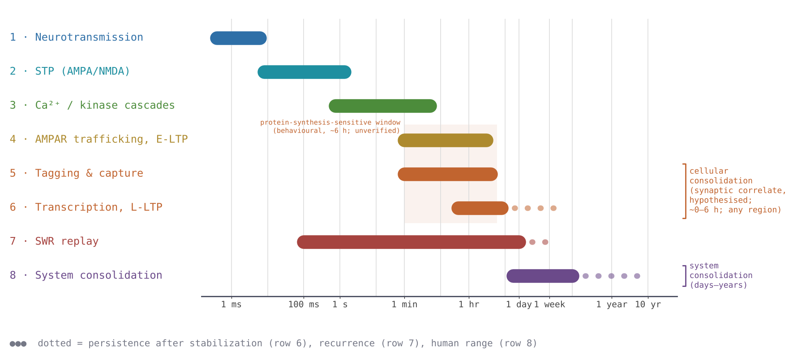

# Hippocampal Plasticity Model: Timescales, Tag/Capture and Dendritic Integration

This document describes the model at the biological and computational level. Hardware realizations
(memristive and digital) are in the companion document
[hippocampal_memristive_implementation.md](hippocampal_memristive_implementation.md); the NEURON
implementation plan is [docs/plan.md](docs/plan.md).

## Terminology: two meanings of "consolidation"

"Memory consolidation" names two different processes. This document always says which one is meant,
and does not use the word unqualified.

- **Cellular consolidation.** For about 6 h after learning (e.g. fear conditioning), the memory can
  be removed by blocking protein synthesis; after that window it is insensitive to the same
  treatment. The memory therefore becomes stable in a process that needs new proteins and about 6 h.
  It happens locally, in each region that stores the memory: in the hippocampus, and equally in the
  neocortex, the amygdala and elsewhere. Late-LTP and synaptic tagging and capture (§2) are candidate
  synaptic correlates of cellular consolidation; this link is a hypothesis, not an identity.
- **System consolidation.** Newly formed spatial or declarative memories are lost if the hippocampus
  is impaired days to weeks after learning, but survive hippocampal damage after a longer interval.
  It is a gradual process between hippocampus and neocortex, lasting days or longer; sleep may play a
  role. The observation shows that the memory stops *depending* on the hippocampus; it does not show
  that the memory has disappeared from the hippocampus.

*Source of these definitions: comment by Edu (hippocampal neuroscientist), personal communication,
October 2026. The ~6 h window is a behavioural figure (rodent, fear conditioning); it is not yet checked
against primary literature and is recorded as unverified in `params.py` (`SLOW_TIMESCALES`).*

## 1. Timescales of plasticity and memory processes

Learning in this system runs on eight processes spanning nine orders of magnitude, from a single
receptor gating event to a memory becoming independent of the hippocampus over weeks to years. Only
some of them are consolidation: three are fast signalling and induction processes, one is a decaying
early phase, two are the (hypothesised) synaptic correlate of cellular consolidation, one is a network
event, and one is system consolidation.



*Fig. 1 — The eight plasticity and memory processes on one log time axis. Brackets mark the
hypothesised synaptic correlate of cellular consolidation (rows 5–6) and system consolidation (row 8).
Row 6's solid bar is the stabilization time; its dotted tail is persistence. The shaded band is the
behavioural protein-synthesis-sensitive window (~6 h after learning; unverified), drawn on the same
duration axis. Generated by
`figures/src/make_timescale_axis.py`. Full molecular detail (receptor subunits, kinase cascades, transcription
factors) is in the companion [Consolidation Cascade](https://claude.ai/code/artifact/f879468e-00e8-4ca1-9acc-348b12cc7e33) document.*

| # | Process | Time constant | Class | Where | Role in the model |
|---|---|---|---|---|---|
| 1 | Neurotransmission (AMPA/NMDA gating) | ~0.5–5 ms | Signalling (not consolidation) | Every synapse | Fastest timescale in the system. |
| 2 | Short-term plasticity | ~10 ms–1 s | Signalling (not consolidation) | Every synapse | NMDAR's slower deactivation is *why* a ±20 ms coincidence window exists — a biophysical constant, not a modeling convenience. |
| 3 | Ca²⁺/kinase cascades | ~1 s–5 min | Induction (not consolidation) | Synapse / dendritic segment | The weight-update decision is made on this timescale. |
| 4 | AMPAR trafficking / early-LTP | ~1–30 min, decays over 1–3 h | Early phase: protein-synthesis-independent, decays | Synapse | A decaying analog state, carried by the tag (§2). |
| 5 | Synaptic tagging & capture | tag set in 1–2 min, decays τ ≈ 1–4 h | Cellular consolidation (synaptic correlate, hypothesised) | Synapse; PRP pool cell-wide | A local, transient, decaying signal that is either captured or lost (§2). |
| 6 | Transcription / late-LTP | onset ~30–60 min; **stabilized by ~4–8 h** | Cellular consolidation (synaptic correlate, hypothesised) | Synapse / cell, in any region that stores the memory | Once captured, the state stops decaying — a discrete regime change, not a continuous process. |
| 7 | Sharp-wave-ripple (SWR) replay | ripple 100–300 ms, recurs over hours–days | Network event (not itself consolidation) | Hippocampal network | Replay within hours of learning can drive capture (cellular consolidation, §2); replay over days is the proposed driver of system consolidation (§4). |
| 8 | System consolidation | days–weeks (rodent) to months–years (human) | System consolidation | Hippocampus ↔ neocortex | Gradual loss of the memory's dependence on the hippocampus (§4). |

**Stabilization time versus persistence (row 6).** Two different quantities are attached to late-LTP
and must not be merged:

- *Stabilization time*: how long until the potentiated state no longer needs protein synthesis and
  no longer decays — ~4–8 h, consistent with the ~6 h behavioural window of cellular consolidation.
- *Persistence*: how long the stabilized state then lasts — days or longer. An earlier version of this
  specification gave late-LTP as "stable ~2 days"; that figure is a persistence value, not a
  stabilization time, and its source is not given (unverified).

The ~6 h behavioural window and the protein-synthesis-sensitivity window of late-LTP in slices need not
coincide; which of the two a simulation is compared with must be stated.

## 2. Synaptic tagging and capture

The synaptic tagging-and-capture (STC) mechanism described in the hippocampal plasticity literature has
a clean dynamical reading: a tag is set by coincident activity, decays with a fixed time constant if
nothing happens, and is *captured* — converted to a stable, non-decaying state — only if a separate
signal (biologically, a plasticity-related-protein (PRP) pool) crosses threshold before the tag decays.
In this model STC is the synaptic-level candidate for **cellular consolidation**: blocking PRP
synthesis is the model's analogue of a protein-synthesis inhibitor.


*Fig. 2 — The tag-decay/capture dynamic, and the falsification test it implies. Both traces receive
identical STDP-driven jumps per event (replay quality is unaffected either way); they diverge only in
whether the tag gets captured before it decays. Because the tag decays with τ_tag ≈ 1–4 h, the
staircase can build only if the events fall within hours of each other: Fig. 2 shows cellular
consolidation driven by replay, not system consolidation.*

The dashed trace is the predicted signature if capture is blocked entirely: the weight distribution
stays flat while replay quality (measured independently) stays unchanged, separating the replay
mechanism from the cellular-consolidation (capture) mechanism.

This section specifies the tag's *time-domain* behavior — onset, decay, capture. §3.4 specifies a
second, independent axis, tag *amplitude*, using the `V_seg` state variable introduced there.

## 3. The dendritic-convolution neuron architecture


*Fig. 3 — High-level neuron architecture, shown as two layers over the same physical topology:
(A) synapse and dendritic-spike generation, and the timescales of dendritic-spike propagation along the
dendritic tree; (B) synaptic homeostasis, short-term plasticity, and neuromodulation-driven tagging —
through E-LTP, L-LTP, and replay — to consolidation, each mapped to the neuronal compartment where it
occurs. Panel B's somatic box reads "cellular consolidation": the single-neuron process (E-LTP →
L-LTP); system consolidation is a network process (§4).*

### 3.1 Layer A — dendritic-spike timescales

Signals move through three physical stages, each with its own characteristic delay: synaptic areas
generate dendritic spikes in about 1 ms; two levels of dendritic junctions integrate those spikes over
5–10 ms per level; the soma converts the result into an output spike over a further 5–10 ms. The model
treats this as a three-stage information-reduction pipeline — postsynaptic threshold, OR-gated
refractory junction, somatic summation.

### 3.2 Layer B — learning mechanisms mapped to the architecture

The same three compartments host the learning mechanisms from §1 and §2:

- **Synaptic areas** receive two distinct inputs — excitatory drive and a separate neuromodulatory
  input — and are where synaptic homeostasis (activity-dependent weight decay), short-term plasticity,
  and neuromodulation-triggered tagging take place.
- **Junctions** implement the OR-plus-refractory primitive (§3.3).
- **The soma** is where E-LTP and L-LTP — the synaptic correlate of cellular consolidation — resolve for
  a single neuron; an ensemble of somas firing together implements sharp-wave-ripple replay, and
  repeated replay across the network is the proposed driver of system consolidation (§4).

### 3.3 Reference topology, block by block

The figure specifies a concrete two-cluster instance, described block by block below.

**Excitatory side.** `Cluster1` groups six excitatory synapses (`ex_syn0`…`ex_syn4`, `ex_synN`);
`Cluster2` groups three more (`ex_syn0`, `ex_syn1`, `ex_synN`) — two independent dendritic segments,
sized differently, which is itself a statement that the pipeline does not assume uniform fan-in per
branch. Every excitatory synapse feeds its own per-synapse `thr` unit in the leftmost, **1 ms** column —
the stage-1 postsynaptic threshold, instantiated once per synapse, not shared. Within `Cluster1`, two of
the six threshold outputs (`ex_syn2`, `ex_syn3`) are drawn joining on a short local wire before entering
the junction; the other four converge on the same junction along separate wires. This is a
wiring-topology detail, not a functional one — all six thresholded outputs feed the same first-tier
junction, which is a plain OR: the diagram's local pairing of two wires versus four individual ones has
no effect on the OR's logic, only on layout.

**Multi-level junction hierarchy.** The junction stage generalizes to `N` tiers: each tier's junctions
take the previous tier's `jSpike` outputs as their inputs, applying the same OR-plus-refractory
primitive at every level, with tier count set by the dendritic-tree depth to be modeled. The reference
diagram specifies the `N = 2` case as a concrete, minimal instance: each cluster's thresholded outputs
converge on its *own* first-tier `junction th/rp`, in the first **5–10 ms** column — one junction
instance per cluster, each carrying an independently-settable `τ_rf` in that range — and both
first-tier junctions' outputs converge on a single second-tier `junction th/rp`, in the second
**5–10 ms** column. The same `th/rp` primitive appears three times in this two-tier instance (twice at
tier 1, once at tier 2) with identical internal structure and independently tunable timing per
instance, which extends to any `N` by replicating the primitive. The worst-case synapse-to-soma latency
contributed by the hierarchy is `N` stacked `τ_rf` periods; for the diagram's `N = 2` at 5–10 ms per
level, this is 10–20 ms.

**Inhibitory bypass.** `Cluster3` (`in_syn0`, `in_syn1`, `in_synN`) connects directly to the
`Soma th/rp` block with a single wire each, passing through no `thr` unit and no junction at all. This
is the diagram's explicit statement that fast, proximal/perisomatic inhibition is exempt from the
threshold-and-refractory pipeline that every excitatory input must pass through — consistent with
basket-cell-type inhibition acting close to the soma rather than being integrated dendritically.

**Somatic stage and output.** The second-tier junction's output and `Cluster3`'s direct inhibitory lines
both arrive at `Soma th/rp`, which is the same threshold-plus-refractory primitive again, just with a
different fan-in, a different threshold, and (presumably) a different `τ_rf`, implementing differential
E/I summation. Its output feeds a final `axon delay` block, drawn as a separate stage outside the soma
and outside all `τ_rf`-scale dynamics — a fixed propagation delay applied only after the somatic
decision has already been made, decoupling millisecond-scale dendritic computation from downstream
conduction latency.

### 3.4 Graded synaptic-potential state per segment (`V_seg`)

Each `thr` unit reduces its segment's drive to a single bit the instant it crosses threshold,
discarding the graded depolarization that led up to that crossing. But NMDA-receptor conductance is
voltage-dependent (Mg²⁺-block relief follows a sigmoid of local depolarization; Jahr & Stevens, 1990),
so the calcium influx driving tag-setting in §2 scales continuously with subthreshold depolarization
rather than with a single all-or-nothing spike — consistent with voltage-based plasticity models
(Clopath, Büsing, Vasilaki & Gerstner, *Nat. Neurosci.* 13:344–352, 2010) and the calcium-control
hypothesis (Lisman, 1989; Shouval, Bear & Cooper, 2002): induction *strength*, not only induction
occurrence, sets the outcome.

`V_seg` is one continuous state per dendritic segment (per `thr` unit, not per synapse), a leaky
integration of the segment's synaptic input carried alongside the existing boolean `thr` output:

```
τ_v · dV_seg/dt = −V_seg + Σ_i w_i · s_i(t)
```

with `τ_v` in the 10–30 ms range already assigned to short-term plasticity in §1. A sigmoid gain
`g_Ca(V_seg) = 1/(1 + K·exp(−λ·V_seg))`, patterned on the NMDAR unblock curve, converts `V_seg` into a
tag-induction amplitude: `tag_amplitude ∝ g_Ca(V_seg) · [dSpike fired]`. This leaves §2's time-domain
claims (`τ_tag`, the capture gate, the falsification test) unmodified — only the tag's *initial height*
becomes graded instead of fixed.

Because `V_seg` is shared across all synapses on one segment, several individually subthreshold
synapses can jointly drive it into the steep part of `g_Ca` without any one of them firing a dSpike —
giving synaptic clustering a mechanistic channel, voltage-dependent cooperativity, alongside its
wiring-based one. It predicts a companion falsification test: dose-dependent partial NMDAR blockade
should shrink captured-weight step size continuously, rather than switching captured synapses to
uncaptured all-or-nothing.

### 3.5 Passive EPSP current versus dendritic spikes in somatic spike generation

Both `thr` and `V_seg` carry dendritic-spike-related current to the soma. A second, parallel pathway is
passive electrotonic spread of the EPSP via axial current, independent of any dendritic spike.

A single spine-level passive EPSP reaching the soma is 0.1–2 mV, against a 15–20 mV gap from rest to
somatic threshold — roughly 1–5% of what firing requires per event, so reaching threshold this way alone
needs summation across tens to hundreds of quasi-coincident inputs. A dendritic spike delivers 5–15 mV
per event, one to two orders of magnitude more — which is why the pipeline digitizes the `thr`
threshold-crossing event rather than the raw EPSP waveform. Dendritic democratization (Magee & Cook,
2000; Andrasfalvy & Magee, 2001) means unitary conductance scales with distance from the soma, so a
passive, non-boosted EPSP stays a graded, spatially-distributed, always-on contribution regardless of
whether any given segment's `thr` fires.

In the topology as specified (§3.3), every excitatory synapse routes through its segment's `thr` unit
before reaching the junction hierarchy or the soma; `Cluster3`'s inhibitory line is the only bypass,
justified by perisomatic targeting, and has no excitatory counterpart. The pipeline represents
coincident threshold-crossing input (`thr`, junctions) and cooperative subthreshold drive toward tag
induction (`V_seg`, §3.4) — it does not represent subthreshold input summed linearly toward the somatic
threshold itself.

For this pipeline's target function — coincidence detection and timing (the ±20 ms STDP window,
tag/capture, SWR replay-order fidelity) — the dendritic spike is the dominant driver of somatic firing,
and the boolean `thr` abstraction is the right compression. A graded, rate-coded excitatory
contribution to the somatic decision, independent of any single coincidence event, is not represented
here; adding it would need a third input to `Soma th/rp` — a low-pass-filtered sum of excitatory `V_seg`
states — which is outside `V_seg`'s scope as specified in §3.4 (tag induction only).

## 4. System consolidation

System consolidation (§1, row 8) is a network process between hippocampus and neocortex over days to
weeks (rodent) or longer. In this model, sharp-wave-ripple replay (§1, row 7) is the proposed driver:
each SWR event replays a compressed version of a stored sequence, and repeated replay over days is what
makes the memory independent of the hippocampus. Its rate is limited by how often replay revisits a
given trace, which is why system consolidation is orders of magnitude slower than tagging and capture.

Two constraints follow from the terminology above:

- The neocortical side of system consolidation needs its own **cellular** consolidation: cellular
  consolidation is not hippocampus-specific, so cortical synapses written by replay stabilize through a
  local, protein-synthesis-dependent step of their own.
- The defining observation is loss of *dependence* on the hippocampus. Whether the hippocampal trace is
  removed, retained or transformed after system consolidation is not determined by that observation.
  The hardware mapping in the companion document (§6 there) leaves the fast tier's state after system
  consolidation as a free parameter, so that the standard, multiple-trace and trace-transformation
  accounts all remain expressible.

System consolidation is outside the scope of the NEURON implementation ([docs/plan.md](docs/plan.md)),
which models §1–§3 in one CA1 pyramidal cell and its interneurons: short-term plasticity and the
synaptic correlate of hippocampal cellular consolidation.
